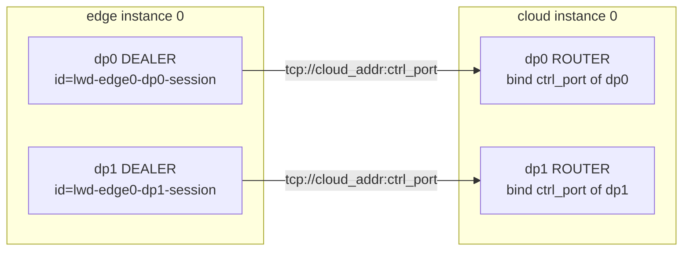
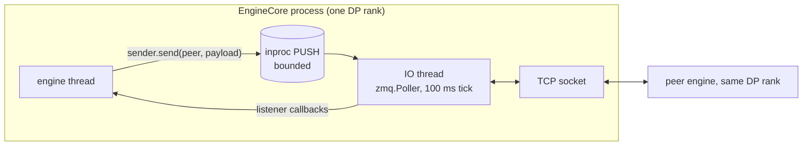
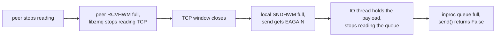
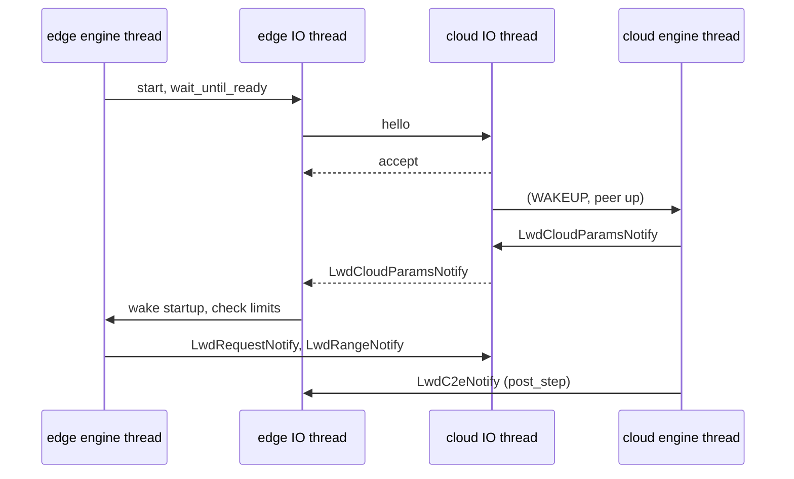

# LWD Control Plane (ROUTER/DEALER)

The LWD (layerwise disaggregated) control plane carries scheduling metadata between edge and cloud engines. Tensors never travel on it; they use the data plane.

## Motivation

The previous implementation (`vllm/v1/lwd_control/control_communication/`, from branch `prefill_only_chunked_prefill_mm`) used two one-way PUSH/PULL pipes: PRE_OUT from edge to cloud, and POST_OUT from cloud to edge. It had these problems:

- The cloud announced itself with a HELLO that was never acknowledged.
- Ports were fixed at 5558 and 5559, so a second DP rank failed with `EADDRINUSE`.
- Sockets were created on one thread and used on another, and `ctx.term()` could hang at shutdown.
- The transport's default codec was the business message codec, so the transport could not carry anything else.

This design replaces both pipes with one bidirectional ROUTER/DEALER link per DP rank and separates the link from the messages it carries.

## Topology



- The cloud listens and the edge connects, in every deployment scene. There is no broker.
- Every DP rank is its own EngineCore process and owns its own control plane: one ZMQ context, one IO thread, one TCP link. Edge DP rank `i` talks to cloud DP rank `i`.
- The edge identity `lwd-edge{instance_id}-dp{dp_rank}-{session_id}` is unique per edge process, so a cloud DP rank can tell several edges apart once it serves more than one. The session id also keeps two misconfigured edges with the same instance and rank apart at the ZMQ layer: the later one is rejected in the handshake, and the working one stays connected.

## Layers

| Layer | File | Knows about |
| --- | --- | --- |
| Business messages | `vllm/v1/lwd_control/lwd_comm/lwd_messages.py` | Request, range, abort, cloud params and step metadata structs and their codecs |
| Link protocol | `lwd_link_protocol.py` | Frame kinds, `LwdPeer`, hello, accept and reject |
| Handshake | `lwd_handshake.py` | Socket-free registration state machines |
| Transport | `lwd_transport.py` | ROUTER and DEALER sockets, framing |
| Control plane | `lwd_control_plane.py` | IO thread, outbound queue, peer resolution, public API |
| Factory | `lwd_control_plane_factory.py` | Maps `VllmConfig.lwd_config` to the control plane of one DP rank |
| Engine integration | `control_scheduler/lwd_base_engine.py`, `control_edge_scheduler/lwd_edge_engine.py`, `control_cloud_scheduler/lwd_cloud_engine.py` | Starting the plane, handing its events to the engine thread, sending scheduler messages |

The link passes business payloads through as bytes. The only coupling between the two layers is `LWD_MESSAGE_VERSION`, which the handshake checks so that both sides speak the same message set. Only the factory reads `LwdConfig`; the layers below take endpoints and ids as arguments.

## Frames

| Side | Multipart message |
| --- | --- |
| Edge DEALER | `[kind, body]` |
| Cloud ROUTER | `[identity, kind, body]` |

`kind` is one byte. `LINK` frames carry a link message and are handled inside the plane. `PAYLOAD` frames carry a business payload and go to the caller.

## Messages

| Direction | Message | Content |
| --- | --- | --- |
| edge → cloud | `LwdLinkHello` | link and message versions, instance id, DP rank, DP size, session id |
| cloud → edge | `LwdLinkAccept` | link version, cloud instance id, DP rank, DP size, echoed session id |
| cloud → edge | `LwdLinkReject` | reason |
| edge → cloud | `LwdRequestNotify` | request id, prompt length, sampling fields, prompt block hashes |
| edge → cloud | `LwdRangeNotify` | batch seqno and the prompt chunks of the batch |
| edge → cloud | `LwdAbortNotify` | request id |
| cloud → edge | `LwdCloudParamsNotify` | scheduling limits the edge must match |
| cloud → edge | `LwdC2eNotify` | per-step hidden size, token ranks, accepted counts, finish reasons, data-plane seqno |

The business messages are ported from the old branch. Their fields are owned jointly with the scheduler; changes other than appending a field with a default bump `LWD_MESSAGE_VERSION`. Link messages use map encoding, so a peer on another link version still decodes the hello and receives an explicit reject.

## Handshake

```mermaid
sequenceDiagram
    participant E as Edge IO thread (dp i)
    participant C as Cloud IO thread (dp i)
    loop every hello retry interval until answered
        E->>C: LwdLinkHello(versions, instance_id, dp_rank, dp_size, session_id)
    end
    alt versions, DP rank, DP size and identity match, slot free
        C-->>E: LwdLinkAccept(cloud instance_id, echoed session_id)
        Note over E,C: both sides report on_peer_up; payloads flow
    else mismatch, or the slot is taken
        C-->>E: LwdLinkReject(reason)
        Note over E: wait_until_ready raises LwdHandshakeError
    end
```

- The edge DEALER sets `IMMEDIATE`, so a hello sent while the cloud is unreachable fails at once and is retried on the next tick. The start order of edge and cloud does not matter.
- The cloud answers a retried hello of the registered session with another accept.
- A cloud DP rank currently serves one edge. A hello from another edge instance is rejected and the registered edge keeps working.
- A hello from the registered edge instance with a new session id comes from another process with the same configuration: a duplicate edge, or a restarted one. Peer loss is not detected yet, so the cloud cannot tell them apart; it rejects the new session, names the registered session, and asks to fix the deployment or restart the cloud.

## Interface

```python
plane = lwd_create_control_plane(vllm_config.lwd_config, dp_rank, dp_size)
sender = plane.start(listener)       # LwdControlListener: on_peer_up, on_message, on_fatal
cloud = plane.wait_until_ready()     # edge only
sender.send(peer, payload)           # False means backpressure
plane.shutdown()
```

- `dp_rank` is `ParallelConfig.data_parallel_index`. `dp_size` must be the global DP size: non-MoE engine processes reset `ParallelConfig.data_parallel_size` to 1 before the engine is built, so the caller must read it before that.
- `LwdCloudControlPlane` and `LwdEdgeControlPlane` can also be built from explicit `LwdCloudControlPlaneSpec` / `LwdEdgeControlPlaneSpec`, for callers without a topology.

## Configuration mapping

| Role | Endpoint | Source |
| --- | --- | --- |
| Cloud | binds `tcp://0.0.0.0:{ctrl_port}` (`[::]` for IPv6) | `ctrl_port` of this instance's DP `dp_rank` |
| Edge | connects `tcp://{addr}:{ctrl_port}` | the cloud DP of the same index in `LwdConfig.connections` |

- The cloud binds every interface rather than its topology address, which may not be a local interface behind NAT or in a container.
- `dp_size` must equal the DP count of the instance in the topology, and `dp_rank` must be in range; otherwise `ValueError`.
- A DP rank with more than one entry in `LwdConfig.connections` raises `NotImplementedError`. `single_instance` and `edge_share` have one DP connection per DP rank; `cloud_share` and `lwd_cluster` need the multi-peer follow-ups.
- Listener callbacks run on the IO thread and must not block. The caller decides how to hand payloads to the engine thread.
- `send()` may only be called on the thread that called `start()`.

## Thread model



- The IO thread is the only thread that touches the TCP socket.
- The outbound queue is bounded by an inproc PUSH with a high-water mark. The IO side uses `RCVHWM=1`, because an inproc pipe holds `SNDHWM + RCVHWM` messages.

### Backpressure

The TCP socket bounds both directions to 1000 messages per connection (`_LWD_LINK_HWM`). When the link cannot take a payload, the IO thread holds it, stops reading the outbound queue and retries every 10 ms, so the queue fills and `send()` returns False. Payloads are neither dropped nor reordered while held.



- The edge treats a lost cloud the same way: without a connection its DEALER reports a full link, so payloads wait instead of being dropped.
- Backpressure only covers the link: it fires when the peer's IO thread or the network stalls. The engines hand inbound messages to unbounded queues (`input_queue`, the edge `unembed_notify_queue`, the cloud `LwdPrefillNotifyQueue`), so a slow engine does not back up the link.
- One held payload blocks every peer of the plane; with one peer per plane today this only affects that peer.

## Engine integration

`LwdBaseEngineCore` (`vllm/v1/lwd_control/control_scheduler/lwd_base_engine.py`) owns the control plane of its DP rank; `LwdEdgeEngineCore` and `LwdCloudEngineCore` add the role behavior.

- `run_engine_core` reads the global DP size before `reconfigure_for_independent_dp_rank()` resets it to 1 and passes it as `lwd_dp_size`. MoE engines with data parallelism are rejected.
- Once the engine is built, `_lwd_assemble()` starts the plane on the engine thread, which therefore owns the sender. READY has already reached the frontend at that point, as with the earlier pub/sub engines. If assembly fails, the engine shuts itself down and startup fails.
- Edge startup blocks until the cloud accepts the handshake and sends `LwdCloudParamsNotify`, both within one `handshake_timeout_s`. `max_num_batched_tokens` and `max_num_seqs` must match the cloud; the speculative factor is adopted from the cloud.
- The cloud sends `LwdCloudParamsNotify` to an edge before anything else, as soon as it registers.



Callbacks run on the IO thread and only hand events over:

| Event on the IO thread | Hand-over | Handled by |
| --- | --- | --- |
| `on_peer_up` | `(WAKEUP, _LwdPeerUp)` on `input_queue` | engine thread; the cloud sends its scheduling limits |
| Edge receives `LwdCloudParamsNotify` | event | edge startup |
| Edge receives `LwdC2eNotify` | scheduler `unembed_notify_queue` + `WAKEUP` | `schedule()` |
| Cloud receives `LwdRangeNotify` / `LwdRequestNotify` | ingest thread | range: `prefill_notify_queue` + pre-recv hint; request: built there, then native `ADD` |
| Malformed payload or unknown type | dropped with a warning | — |
| Handler exception, `on_fatal` | `(EXECUTOR_FAILED, _LwdControlPlaneFailed)` | engine thread raises; the engine fails |

The cloud ingest thread keeps request building (placeholder embeds) and the pre-recv hint, which may block, off the IO thread, so step metadata to the edge is not delayed behind them. `input_queue` FIFO puts a peer-up before any request of that peer.

Sending:

- Edge: `LwdRangeNotify` (scheduler) and `LwdRequestNotify` (`add_request`) retry a full queue 5 times over about 3 s, then raise. A scheduled batch is never dropped: scheduling already advanced its progress, so a lost chunk would desynchronize the cloud.
- Cloud: `LwdC2eNotify` (flushed in `post_step`) and the scheduling limits retry until queued, and give up only once shutdown is requested.

## Failure semantics

| Event | Behavior |
| --- | --- |
| Outbound queue full | `send()` returns False |
| Peer stops reading, or the network stalls | The link fills up and the IO thread holds payloads until `send()` returns False; see [Backpressure](#backpressure) |
| `send()` to a peer that has not registered, or after shutdown | `LwdPeerNotRegisteredError` |
| Malformed or unknown frame | Dropped with a warning; the link stays up |
| Payload from an unregistered identity | Dropped with a warning |
| Handshake reject or timeout on the edge | `wait_until_ready` shuts the plane down and raises `LwdHandshakeError` |
| Port in use on the cloud | `start()` raises `LwdControlPlaneStartupError` |
| Peer process exits | Not detected; no callback fires. The cloud drops payloads to a vanished edge with an error log; the edge holds payloads to a vanished cloud, so its `send()` soon returns False |
| Network partition | Not detected by the plane. TCP keepalive drops an idle link after about 2 minutes; a link with unsent data waits for the kernel retransmission timeout. Payloads wait in ZMQ queues meanwhile |
| Edge restarts | Its new session is rejected; restart the cloud as well |
| Duplicate edge with the same instance and DP rank | The later process is rejected with an explicit "same configuration already registered" error; the registered edge keeps working |
| Same edge process reconnects after a network blip | Same identity, so `ROUTER_HANDOVER` resumes the session at once. Payloads in flight during the gap are lost: the edge DEALER (`IMMEDIATE`) discards its queue on disconnect and the cloud drops payloads to the missing connection |
| IO thread crashes | `on_fatal` fires and the plane stops |

The plane never stops the engine on its own; the engine turns `on_fatal` into a failure (see [Engine integration](#engine-integration)). Shutdown is idempotent: it stops the IO thread, discards queued payloads and terminates the context. If the IO thread does not exit within 5 s, the context is destroyed.

## Tunables

The optional `control_plane` block of the topology YAML (`LwdControlPlaneConfig` in `vllm/config/lwd/topology.py`) holds the link tunables. It sits at the top level because edge and cloud must agree on it, and every instance reads the same file. Omitted fields keep their defaults.

```yaml
control_plane:
  send_queue_max: 1000
  hello_retry_interval_s: 5.0
  handshake_timeout_s: 1800.0
```

| Field | Default | Meaning |
| --- | --- | --- |
| `send_queue_max` | 1000 | Outbound messages buffered per DP rank before `send()` returns False, on top of the link's own 1000 per connection |
| `hello_retry_interval_s` | 5 s | Interval between edge hellos until the cloud answers |
| `handshake_timeout_s` | 1800 s | Edge wait for its cloud; must cover a full cloud engine startup |

`lwd_create_control_plane` passes the block into the control plane spec. Callers that build a spec by hand get the defaults.

## ZMQ pitfalls

- `IMMEDIATE`, `ROUTER_MANDATORY` and `ROUTER_HANDOVER` only apply to connections made after they are set. `make_zmq_socket` binds or connects immediately, so the TCP sockets are built by hand.
- On an identity collision ZMQ either disconnects the old connection (`ROUTER_HANDOVER`) or silently ignores the new one; it cannot tell a reconnect from a second process. Putting the session id in the identity removes collisions between processes, so handover only ever resumes the same process.
- `ROUTER_MANDATORY` turns a send to an unknown identity into `EHOSTUNREACH` instead of a silent drop, and a send to a full connection into `EAGAIN`.
- A DEALER reports `EAGAIN` both when it is not connected (`IMMEDIATE`) and when its high-water mark is reached; the plane treats both as a full link.
- A ROUTER always reports `POLLOUT`, so a held payload is retried on a timer rather than on writability.
- `SNDHWM=0` / `RCVHWM=0` mean unbounded. Both directions must be bounded for backpressure: an unbounded receive side lets libzmq keep reading TCP into memory.
- `ctx.term()` blocks until every socket is closed. The engine-owned PUSH is closed by `shutdown()` on the engine thread.
- TCP keepalive (60 s idle, 10 s interval, 6 probes) is a stopgap until application heartbeats: it only detects a dead peer on an idle connection.

## Roadmap

This change delivers the link, the handshake, the business messages, the factory, backpressure and the engine integration. Each follow-up below keeps the interface above.

| Follow-up | Content |
| --- | --- |
| Peer loss detection | Per-session application heartbeats, `on_peer_down`; a lease decides a new session: rejected while the registered one is alive (duplicate), accepted once it expires (restart) |
| Several edges per cloud DP rank | Session table on the cloud, per-peer outbound queues and failure isolation; enables `cloud_share` |
| Several clouds per edge DP rank | Several links per edge plane; enables `lwd_cluster` |
| Tests | API-level tests through the factory once configuration and schedulers settle |
| Lifecycle | Reconnect after a cloud restart without losing payloads in flight, flushing queued payloads at shutdown, discovery, authentication |
