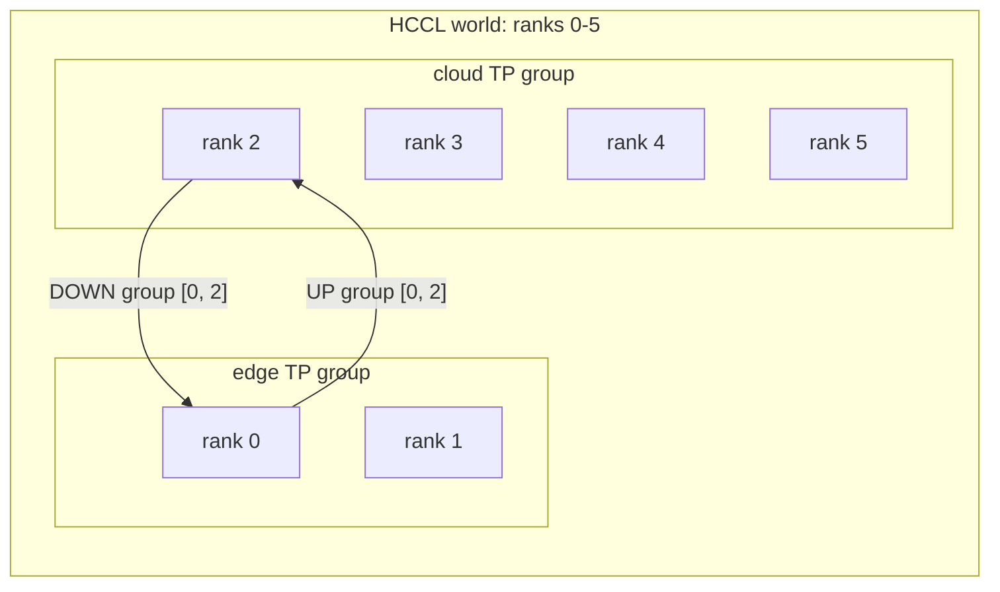

# LWD Data Plane

The LWD (layerwise disaggregated) data plane carries tensors between edge and cloud workers: the prompt embeddings of each prefill batch go up, the final hidden states of each cloud step come down. Scheduling metadata travels on the [control plane](lwd_control_plane.md) instead.

The data plane spans two repositories:

| Part | Location | Knows about |
| --- | --- | --- |
| Rank groups | `vllm/distributed/lwd/lwd_parallel_groups.py` | `LwdParallelGroupsSpec`: the groups every process builds, derived from the topology |
| vLLM groups | `_initialize_lwd_model_parallel` in `vllm/distributed/parallel_state.py` | TP/PP/DCP/PCP/DP/EP groups of the shared world |
| Ascend groups | `vllm_ascend/distributed/lwd_data_plane/lwd_parallel_groups.py`, called from `init_ascend_model_parallel` | MC2 and dynamic EPLB groups |
| Channels | `vllm_ascend/distributed/lwd_data_plane/lwd_wire.py` | UP/DOWN groups, streams and warmup per DP connection |
| Comm service | `vllm_ascend/distributed/lwd_data_plane/{service,channel,future,types}.py` | Async send/recv submission, per-channel seqno FIFO, completion futures |
| Payload scramble | `vllm_ascend/distributed/lwd_data_plane/payload_scramble.py` | Obfuscating the hidden states on the wire |

## Communication domains

HCCL builds a communicator from a world that every rank joins, so the edge and cloud instances form one HCCL world whose ranks are the global ranks in the topology (`hccl_world_size`, `dp[].ranks`). Inside that world:

- each edge instance DP and each cloud instance DP runs like a centralized pp=1 deployment: its ranks are one TP group, and the PP, DCP, PCP and DP groups are singletons;
- the EP and MC2 groups equal the TP groups;
- each DP connection adds two groups, UP and DOWN, over its endpoint pair: the first edge rank and the first cloud rank (`cloud_leader_rank`).

Example: one edge instance on ranks 0-1, one cloud instance on ranks 2-5.

| Group | Ranks |
| --- | --- |
| world | `[0, 1, 2, 3, 4, 5]` |
| TP / EP / MC2 | `[0, 1]`, `[2, 3, 4, 5]` |
| PP / DCP / PCP / DP | `[0]`, `[1]`, ..., `[5]` |
| UP, DOWN | `[0, 2]` |

Group creation is a world collective, so every process derives the same `LwdParallelGroupsSpec` from the same topology and creates the groups in the same order: the vLLM groups in `initialize_model_parallel`, then the Ascend groups in `init_ascend_model_parallel`, then the channel groups in `init_lwd_duplex_channels`. Configs the data plane cannot host (an unsupported topology or parallel feature, or a tensor parallel size other than the DP rank count) are rejected by `check_lwd_parallel_config` in `VllmConfig.__post_init__`; the edge and the cloud read the same topology, so both fail at startup, before any worker joins the world.

### No two-stage pipeline

The old branch built a `[edge0, cloud0]` PP group with `pipeline_parallel_size=2` to express the edge-cloud pair, then forced `is_first_rank` and `is_last_rank` to true on that group so that both sides built the full embedding and LM head. Here the PP groups are singletons, so `is_first_rank` and `is_last_rank` hold natively and the native PP paths are skipped by their own `pp.world_size > 1` checks. Neither side splits or concatenates tensors for the other: the edge sends its whole batch, and the cloud spreads what it receives within its TP group.

### Supported topologies

| Scene | Status | Reason |
| --- | --- | --- |
| `single_instance`, 1 DP | Supported | |
| `single_instance`, several DPs | Rejected | The edge DPs share their ranks, and one rank is one process |
| `edge_share` | Rejected | The edge instances share their ranks |
| `cloud_share`, `lwd_cluster` | Rejected | An endpoint rank would hold the channels of several DP connections |

TODO(lwd): give each DP connection its own communication domain, built from rendezvous information exchanged over the control plane, instead of one world shared by every instance. That lifts the shared-rank limit and decouples the lifecycles of the edge and the cloud.

## Channels

| Channel | Direction | Payload | seqno source |
| --- | --- | --- | --- |
| UP | edge → cloud | prompt embeddings of one prefill batch, plus an optional mrope-positions aux frame | edge scheduler batch |
| DOWN | cloud → edge | c2e packet of one cloud step: final hidden states, top-k and accepted counts | cloud worker step |

HCCL P2P has no tags: ops on one communicator pair up in posting order. `LwdCommService` therefore keeps one FIFO per `(channel, op)` and posts a request to HCCL only once all lower seqnos have been posted; out-of-order submissions are held. A seqno skipped on both sides (an aborted request) is stepped over so that one abort does not block the channel. The receiver allocates an exact-size buffer from the size announced on the control plane, since HCCL P2P needs matching sizes on both ends.

Every wire op is issued on its channel's NPU stream and followed by an event; `LwdCommFuture.done()` queries that event without blocking. Both channels are warmed up at initialization in a fixed order (UP, then DOWN), so the first real message cannot rendezvous on different channels on the two sides.

UP takes two hops on the cloud: the channel delivers to the cloud endpoint rank, and the cloud worker broadcasts the rows within its TP group on the compute stream.

## Out of scope

- Starting workers with their global ranks and the topology world size: the executor and worker integration.
- Early receive: the hint and completion side channels between the cloud engine and the cloud endpoint worker move together with that integration.
