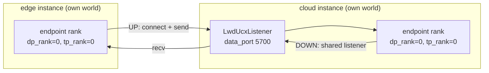

# LWD Host Data Plane

The default LWD data plane (see [lwd_data_plane.md](lwd_data_plane.md)) runs inside one HCCL world shared by the edge and the cloud: channel groups are derived from topology ranks, and every process joins the same collectives.

`deployment.data_plane_comm: host` replaces that with a **host-host RoCE transport** (UCX, wire protocol UHC1). The edge and the cloud become two independent torch worlds: no shared HCCL world, no topology ranks, no cross-side collectives, no `LwdParallelGroupsSpec`. Tensors travel over RoCE as tagged byte streams between peer processes.

| Aspect | `device` (default) | `host` |
| --- | --- | --- |
| Data path | HCCL P2P inside one world | UCX/UHC1 over RoCE |
| Rank model | Global ranks from the topology | No ranks; peers derive endpoints from identity |
| Group creation | Topology-derived groups in `initialize_model_parallel` / `init_ascend_model_parallel` | Skipped; each instance builds its native TP/DP groups |
| Cloud listener | Implicit in the HCCL world | One `data_port` per cloud DP |
| Sizing | HCCL P2P needs matching buffers | Block sizes from the topology, verified per link at handshake |
| Deviceless machines | NPU only | Edge/cloud host processes can run without an NPU device |

## Topology

```yaml
deployment:
  mode: 0
  scene: single_instance
  edges_num: 1
  clouds_num: 1
  data_plane_comm: host          # device | host
  data_plane_host:               # host-only block
    up_buffer_size: 128          # MB; omit to derive it from the model
    down_buffer_size: 32         # MB
    deployment: in_process       # in_process | sidecar
edges:
  - id: 0
    dp:
      - {dp_idx: 0, addr: 10.0.0.1, ctrl_port: 5560}
clouds:
  - id: 0
    dp:
      - {dp_idx: 0, addr: 10.1.0.1, ctrl_port: 5560, data_port: 5700}
qos:
  data_plane: {traffic_class: 106, sl: 5}   # optional
  ctrl_plane: {dscp: 26}                    # optional
```

| Field | Meaning |
| --- | --- |
| `deployment.data_plane_comm` | Transport family; `host` selects this document |
| `deployment.data_plane_host.up_buffer_size` | UP block in MB. Omitted (`null`) = derived from `hidden_size`, hash layers and `max_num_batched_tokens`, rounded up to 32 MiB |
| `deployment.data_plane_host.down_buffer_size` | DOWN block in MB, used as configured (default 32) |
| `deployment.data_plane_host.deployment` | `in_process` = transport inside each engine; `sidecar` = one transport daemon per host |
| `dp[].data_port` | Cloud-only, required on every cloud DP in host mode; the edge never listens |
| `deployment.hccl_world_size`, `dp[].ranks` | Must be omitted in host mode |

`LwdTopology.validate_layout` dispatches to `_validate_host_layout`, which fails startup when ranks or `hccl_world_size` are present, when an edge declares `data_port`, when a cloud DP lacks it, or when one address repeats a `data_port`. `lwd_check_parallel_config` then requires `parallel_config.data_parallel_size == len(instance.dp)`: each DP is its own engine launch.

## Link model

Every DP connection owns **two** UHC1 links, one per direction, each an independent `LwdUcxChannel` with its own UCP endpoint, IO thread and block pool.

- The cloud DP binds one shared `LwdUcxListener` on its `data_port`; both links attach through `serve_via`.
- The edge connects out for both links: UHC1 is full-duplex, so which side binds the handshake socket is independent of the data direction.
- Endpoint process of a connection: `dp_rank == dp_idx` and TP rank 0. Other ranks hold no link objects.



Handshake: the edge sends a fixed header (`magic, addr_len, max_msg, session, token, n_slots, caps_len, put_thresh`) followed by its worker address; the token is `blake2b-8` over `"edge_id:cloud_id:dp_idx:channel"` truncated to 64 bits, so a connection that carries the wrong identity is rejected by the listener's token router instead of being accepted by the wrong channel.

Warmup is asymmetric by design: the cloud starts first and only reports the listener bound, adopting each edge asynchronously; the edge waits for every local link with a bounded `wait_ready` (handshake timeout + 5 s). There is no cross-world barrier to join.

## Transport

`vllm/v1/lwd_comm/data_comm/` is device-agnostic: no torch, no NPU calls.

| Concern | Behaviour |
| --- | --- |
| Framing | seqno is the tag; zero frame header, zero software CRC |
| Receive side | pre-posted wildcard receives from a built-in block pool |
| Send side | `acquire_staging()` takes a pool block, one D2H copy writes into it, `send(tag, addr)` posts it, the completion callback returns it |
| Backpressure | pool depth = in-flight cap |
| Large frames | RMA-put path is disabled (`put_thresh = 0`); a frame larger than the block fails at submit, before queueing |
| Threading | one library IO thread drives completions; user callbacks run on it and must not block |

The NPU assembly (`vllm_ascend/.../lwd_data_plane/host/`) owns the device side: D2H/H2D copies, the per-request pinned staging, the scrambler and the `LwdTransferFuture` wiring. It faces the transport only through `LwdUcxTransportPort`, so an embedded channel and a daemon-attached channel are interchangeable.

## Sidecar mode

With `deployment: sidecar` the listener lives in a dedicated transport daemon, one per host:

- the first engine process spawns it with the parent environment and sets `LD_LIBRARY_PATH` for libucp;
- the engine attaches over a ctl unix socket (protocol version is checked on attach) and passes memfd-backed shared memory with `SCM_RIGHTS`;
- the data path is an SPSC command ring (engine → daemon) and completion ring (daemon → engine) over that shared memory, with two pipe pairs for wake-up instead of polling;
- the daemon owns every channel and listener; an engine exit detaches its sessions, and a daemon with no session for 30 s exits.

`in_process` keeps the same channel code inside the engine and is the default: fewer moving parts, one process to observe.

## Block sizing

Block size is per direction and must match on both peers; it is verified at handshake.

- `up_buffer_size` omitted → `ucx_block_policy.resolve` derives `max_num_batched_tokens × per-token elements × 2 bytes`, rounded up to 32 MiB, with a 128 MiB floor. `per-token elements` is `hidden_size`, plus `4 × num_hash_layers × num_experts_per_tok` for `deepseek_v4`. Nested `text_config` values are used when the top level lacks them.
- An explicit value wins; if it is below the derived requirement, startup logs a warning and the frame that does not fit fails later at submit.
- Unknown model type → fallback 128 MiB with a warning.

Initialization also enforces a per-rank host memory budget (`_HOST_MEM_BUDGET_MB = 12 GiB`): `pools × 4 × (up + down)` must fit, otherwise startup fails with the computed numbers rather than exhausting host memory at runtime.

## QoS

QoS is configuration, not environment:

| Plane | Field | Applied as |
| --- | --- | --- |
| Data | `qos.data_plane.traffic_class` | `IB_TRAFFIC_CLASS` in the UCT config of the link, plus `IP_TOS = traffic_class << 2` on the TCP handshake sockets |
| Data | `qos.data_plane.sl` | `IB_SL` in the same UCT config |
| Control | `qos.ctrl_plane.dscp` | ZMQ `TOS = dscp << 2` on every control socket |

Both peers must carry the same values; effective QoS needs matching switch PFC/ETS policy.

## Failure model

- Startup fails fast: topology validation, missing `data_port`, a frame larger than the block, an exceeded memory budget, a handshake timeout.
- There is no peer-restart recovery: `on_peer_restart` is not wired and seqnos are not reset, so a restarted peer means restarting the whole deployment.
- A broken link surfaces as channel error; the request fails instead of hanging.

## Code map

| Part | Location |
| --- | --- |
| Transport (device-agnostic) | `vllm/v1/lwd_comm/data_comm/`: `sock.py`, `ucx_pool.py`, `ucx_ucp.py`, `ucx_link.py`, `ucx_channel.py`, `ucx_shm.py`, `ucx_port.py`, `ucx_daemon.py` |
| Configuration and validation | `vllm/config/lwd/topology.py` (`LwdHostDataPlane`, `LwdQos*`, `_validate_host_layout`) |
| World-args guard | `vllm/distributed/parallel_state.py`, `vllm/distributed/lwd/lwd_parallel_groups.py` |
| NPU assembly | `vllm_ascend/distributed/lwd_data_plane/host/`: `lwd_host_channels.py`, `ucx_io.py`, `ucx_block_policy.py`, `lwd_host_transfer_queue.py` |
| Queue selection | `vllm_ascend/distributed/lwd_data_plane/lwd_data_plane.py` (`_queue_class`) |
| Ascend groups | `vllm_ascend/distributed/parallel_state.py` (`_lwd_init_ascend_model_parallel`) |

## Tests

| Test | Covers |
| --- | --- |
| `tests/v1/lwd_comm/test_sock.py` | TCP helpers: handshake round-trip, fd ownership across wrap/detach, bounded connect timeout, peer-close return |
| `tests/config/lwd/test_topology.py` | Host layout validation errors and `data_plane_host` misuse |
| `tests/ut/distributed/lwd_data_plane/test_lwd_ucx_block_policy.py` | Block derivation, explicit override, fallback, invalid inputs |
| `tests/ut/distributed/lwd_data_plane/test_lwd_ucx_frame_guard.py` | Submit-time rejection of an oversized frame |

Anything that needs libucp, RoCE hardware or an NPU is verified on the real deployment; see the runbooks in the RFC issue.

## Out of scope

- Multiple edge instances per cloud DP and shared-rank layouts: the current topology validation rejects them in host mode.
- Peer-restart recovery, seqno replay and dynamic link re-planning.
- GPU-side and CPU-side assemblies of the same transport.
