# LWD 多 DP

单实例（`single_instance`）拓扑可以在一个边进程后面运行多个云 DP 引擎。
本文描述边侧如何服务每条 DP 连接、云侧如何保持与集中式 DP 部署一致的行为。

配套文档：[lwd_control_plane.md](lwd_control_plane.md)（ROUTER/DEALER 链路层）、
[lwd_data_plane.md](lwd_data_plane.md)（UP/DOWN 通道与 rank 组）。

## 设计原则

云侧的行为与集中式 DP 部署完全一致；LWD 的增量只有两处——它的流量来自哪里：

- MoE 云侧引擎跑在原生 DP 引擎基座上
  （`LwdCloudDPEngineCore` = `LwdCloudEngineCoreMixin` + `DPEngineCoreProc`），
  完整保留 wave 状态机、dummy batch、START_DP_WAVE 与 dp×tp 专家分片；
  非 MoE 云侧跑独立引擎（`LwdCloudEngineCore`）。
- 边侧是前端替身：用原生 DP 均衡器的评分权重路由请求，并在 wave 暂停时发
  FIRST_REQ 唤醒（没有别的角色会做：云侧自己没有前端流量）。

一句话：把集中式 DP 部署的前端搬到边侧、把 prefill 的 embedding 环节搬到边侧，
云侧其余零改动。

## 部署拓扑

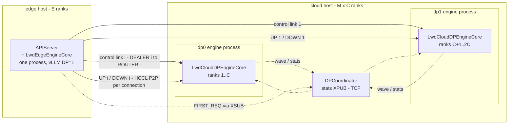

- 边实例的多个 DP 条目共享同一份 ranks（一个进程服务所有连接），
  spec 把它们折叠为一个分配；每个云 DP 是一个独立引擎进程，占自己的 rank 分配。
- 共享 HCCL world 共 `E + M*C` 个 rank；每个进程从同一份拓扑文件推导出同一个
  `LwdParallelGroupsSpec`，建组（世界集合操作）在全 rank 上以相同顺序执行。
- 单实例内多机 DP rank 被拒绝（inner-DP world 按原生均匀网格推导 rank，
  与边云共享 world 的布局不符）。

## Rank 组布局

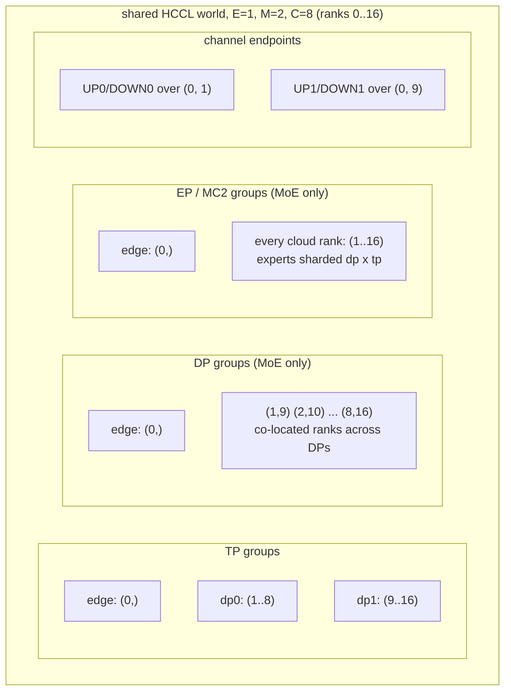

- TP：每个边实例、每个云 DP 一组。PP、DCP、PCP 保持单例（无两段流水线：
  老分支的 `pp=2` 配对与首/尾 rank 改写不允许回来）。
- DP（仅 MoE）：各云 DP 同位 rank 一组——引擎的锁步 all-reduce 在这里跑。
  非 MoE 时 DP 组保持单例（独立引擎）。
- EP / MC2（仅 MoE）：边实例一组 + 罩住该实例全部云 rank 的一组。按引擎分 MC2 组
  会让 token 只路由到 dp×tp 分片专家的一部分（参照分支踩过此坑：输出乱码）。
- 通道：每条 DP 连接一对 UP/DOWN `new_group`，由边端点 rank 与该连接的云首卡持有。
  边端点 rank 持有所有连接的对；云首卡只持自己那对。

## 模块图

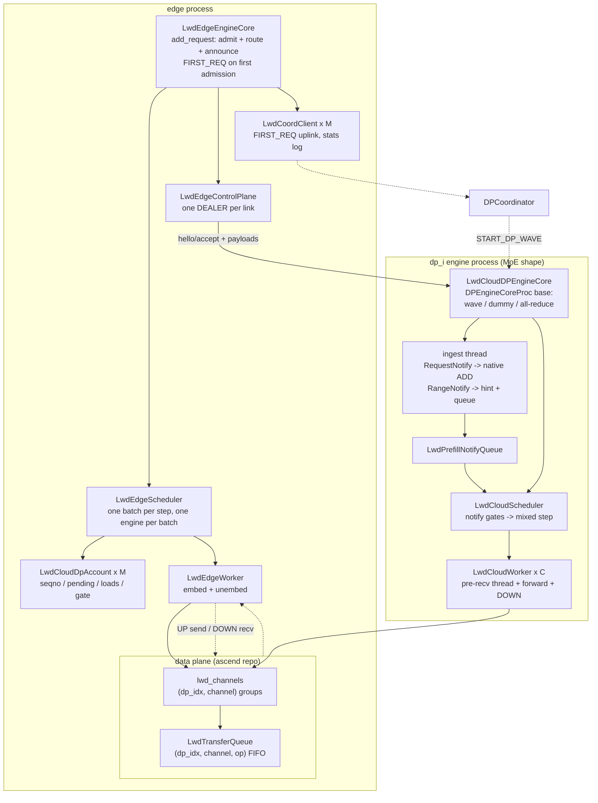

关键模块与单一职责：

| 模块 | 仓库 | 职责 |
| --- | --- | --- |
| `LwdParallelGroupsSpec` | vllm | 两仓共用的唯一 rank 组来源 |
| `LwdEdgeControlPlane` / `LwdEdgeTransport` | vllm | 每链路一个 DEALER、per-peer 持留、按链路索引归因 |
| `LwdCloudDpAccount` | vllm | 一个云 DP 的边侧账本（seqno 流、pending 批、负载、闸门） |
| `LwdEdgeScheduler` | vllm | 每步选引擎、组批、notify 出口 |
| `LwdCloudEngineCoreMixin` + 双基座 | vllm | 云侧 LWD 接缝（ingest、参数、pre-recv MQ、c2e 刷出），基座二选一 |
| `LwdCoordClient` | vllm | 边到 coordinator 的 FIRST_REQ 上行 |
| `lwd_channels` / `LwdDataPlane` | ascend | 按连接键控的通道组与 FIFO 传输队列 |

## 边侧进程拓扑：一个引擎、一个 worker

**边侧只有一个引擎进程、一个 worker，不存在"边的两个引擎"，也不拆分发送。**
多个 DP 连接由同一个 worker 按"批的归属"选择通道：

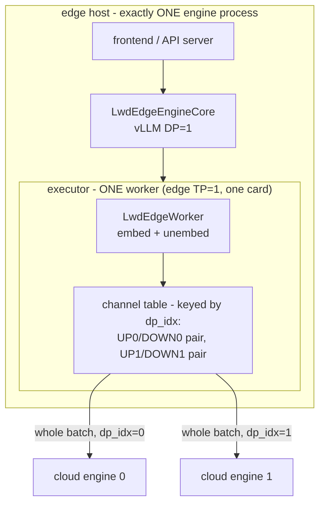

- **发送不拆分**：一个 EMBED 批（其中所有请求路由到同一个引擎）整体走一条 UP 通道，
  `dp_idx` 取自批 meta——worker 不看请求、不重排、不拆包。选择"发哪条通道"发生在
  组批时（调度器保证批内引擎单一），worker 只是按 meta 执行。
- **接收同理**：一个 UNEMBED 批只从一条 DOWN 通道收（批 meta 带 dp_idx），
  不同引擎的结果不会交错到同一批里。
- **对比云侧**：云侧每引擎一个进程、每引擎 8 个 worker（一卡一个）；边侧
  1 引擎 × 1 worker，是集中式 DP=1 部署的原生形态，多 DP 只体现在
  "通道表有多条"上，不体现在进程或 worker 数量上。

### 两个 DP 域都有请求时，embedding 是怎么算的

**答案是第一种：每步只组"一个引擎的批"，交给唯一的 worker 算一次、发一次。**
两个域的请求永远不在同一个 EMBED 批里（批内引擎单一约束），轮到谁就发谁的：

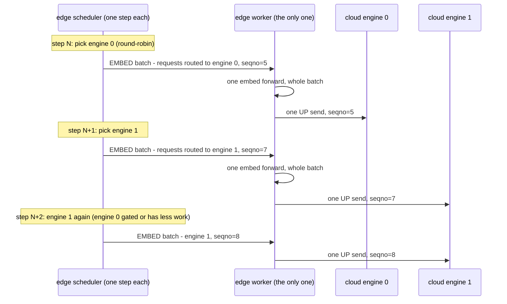

要点：

- **一次前向一个批**：worker 的 embed 前向以批为单位（`model.embed_input_ids` 一次算整批），
  批内 token 全部是"路由到同一引擎"的请求的 chunk——拼批发生在组批时（调度器按路由过滤候选），
  不是发送时再拼。
- **每步只服务一个引擎**（round-robin 轮转）：哪个引擎"有活且过闸"就发谁的批；
  引擎 0 被闸住时引擎 1 可以连续多步被服务，反之亦然。所以两个域的批在时间上交替出现，
  各自独立计 seqno。
- **只有一个 worker**：不存在"给两个 worker 各发一份"——边侧 worker 数量是 1
  （TP=1 一卡），多引擎复用的是同一个 worker 与它的通道表，靠"选哪条通道"区分。
- UNEMBED 同理：一个 c2e 结果 = 一个 UNEMBED 批 = 一次 lm_head 前向 + 一次 DOWN 接收，
  不会把两个引擎的结果混进一个批。

## 初始化与握手：谁先起、怎么对上

**先云后边（或同时起也行——边会重试），全流程有一条硬底线：边没跟齐所有云引擎之前，一个用户请求都不接。**

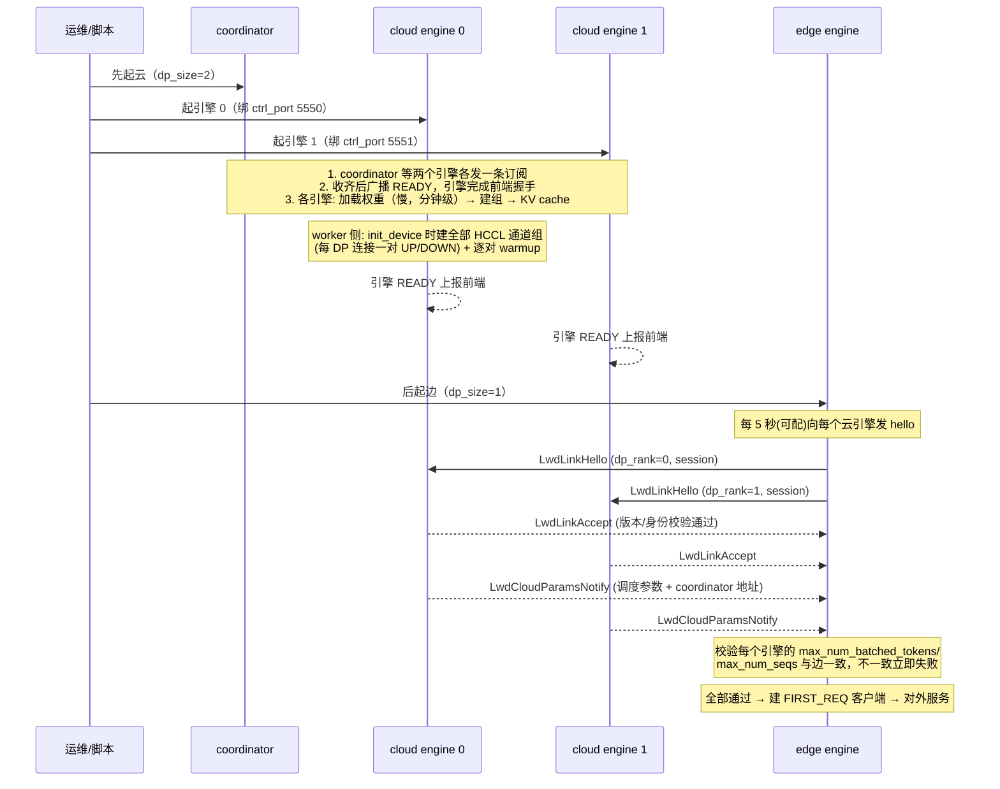

里程碑顺序与要点：

| 阶段 | 谁做什么 | 失败行为 |
| --- | --- | --- |
| 云引擎启动 | coordinator 先等两个引擎订阅齐才广播 READY（引擎才完成与前端握手）；各引擎加载权重、建 HCCL 组、分配 KV cache | 谁没到，云整体起不来（600s 超时） |
| 通道建立 | 每个云引擎的 worker 在 init_device 时建全部 DP 连接的 UP/DOWN 通道组，并**逐对 warmup**（边发小包、云回小包，把 HCCL 建链挪到空载期） | 非端点卡只参与建组的集体动作，不碰通道 |
| 边启动 | 向每个云引擎发 hello（每 5s 重试，重试无害——云晚起也没关系）；**等到所有 M 条链路都 accept** | 任一链路在 handshake_timeout（默认 1800s，覆盖云加载权重的分钟级耗时）内没 accept，边启动失败 |
| 参数校验 | 每个引擎回报自己的 max_num_batched_tokens / max_num_seqs / spec 深度；边逐一比对 | 不一致 fail-fast（会造 成云侧预填永久滞后的静默死锁，宁可当场失败） |
| coordinator 地址 | 每个引擎在 params notify 里带上自己侧 coordinator 的 TCP 地址（LWD 下强制 TCP，不用本机 IPC 路径） | 边拿不到地址 → 不建 FIRST_REQ 客户端（有 ingest 本地唤醒兜底） |
| 开始服务 | 边的 READY 才上报前端；**第一条用户请求来时若云在睡，走 Wave 唤醒** | — |

设计要点两条：

- **双向 fail-fast，不留半活状态**：云没起齐→云整体起不来；边没等齐所有 accept→边不起。
  不存在"边起了但只有一条链路通"的降级形态（那种状态下路由会把请求发给不存在的引擎）。
- **边不知道云的启动进度**，只做无脑重试——hello 每轮都发，云起来了就应。
  顺序无关性靠这个达成：先边后云也能起（边重试到云出现为止）。

## 请求生命周期

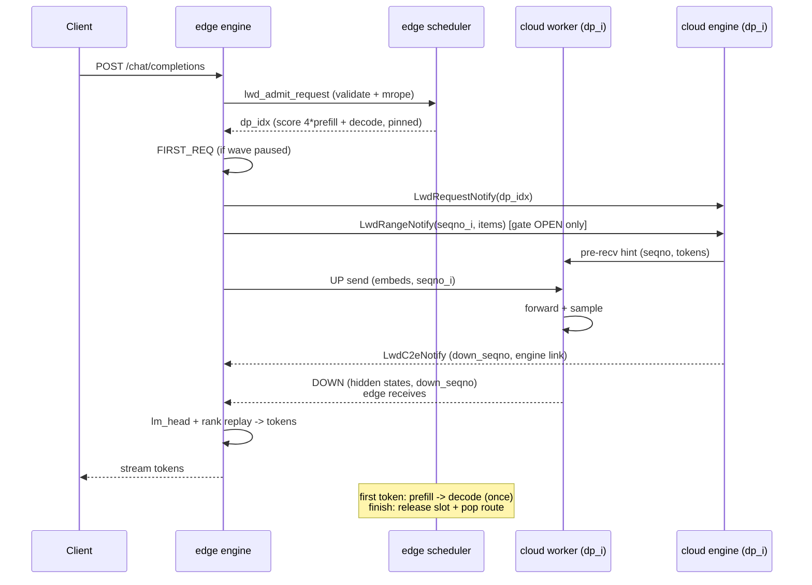

账本状态机（`LwdCloudDpAccount`）：

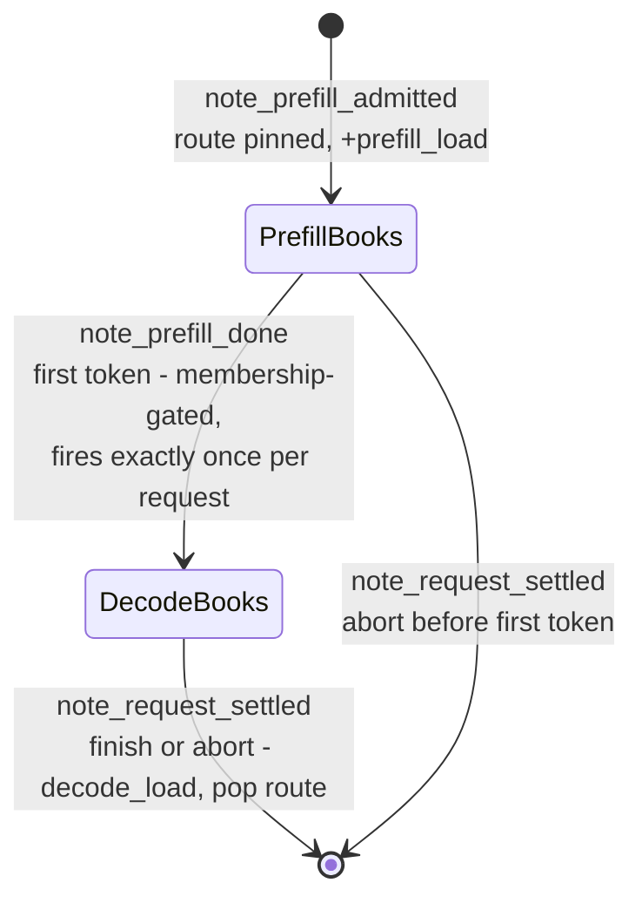

- 每次 token 交付都会进入清账入口（不只是首 token），所以 prefill→decode 的迁移以
  集合成员资格为门、每请求恰好一次：纯计数器会在每个 token 上重复自减变成负数，
  把全部流量钉死在一个引擎；而完结不清账会让槽位泄漏到所有引擎的闸门永久 HOLD、
  两边空转（两个形态都在持续并发压测中出现过，回归测试各自覆盖）。
- 迟到 c2e 撞上已完结请求的 stale 分支同样清账，封住进入账本的最后一个入口。

## 调度协商：谁决定请求归谁

**路由与派发全部由边侧单方决定，云侧不做任何跨引擎协商——这是刻意的设计，不是遗漏。**

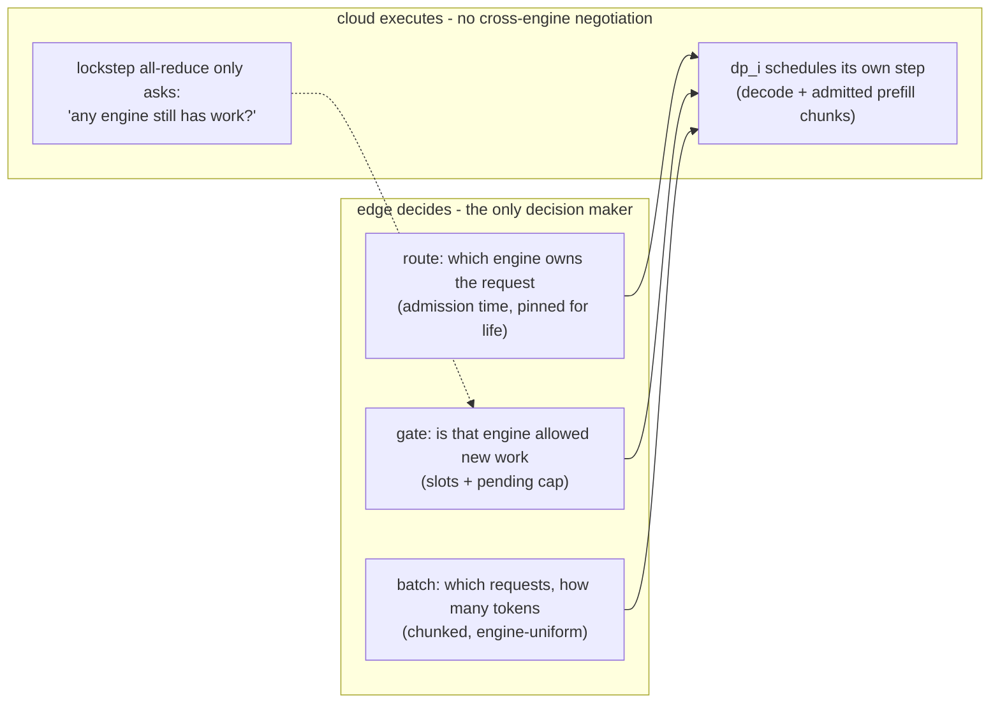

分工与依据：

| 决策 | 归属 | 说明 |
| --- | --- | --- |
| 请求路由到哪个引擎 | **边** | 准入时打分（4×prefill + 1×decode，与原生 DP 负载均衡同权重）、从一而终。云侧不参与：路由变更 = 迁移 KV cache，成本远大于收益 |
| 引擎是否可以接新活（闸门） | **边** | 边是唯一流量入口，只有它知道全局视角的每引擎负载与未消费 chunk 数。云侧各引擎只看得到自己的队列 |
| 每步发什么批 | **边**（派发侧） | 一次一个引擎、批内引擎单一（一条 RangeNotify = 一个 seqno = 一条 UP 通道） |
| 每步算什么批 | **云**（执行侧） | 收到 notify 后，云引擎自主决定本步混合比（decode 优先、prefill 需过三道闸门：请求已登记、UP 数据已收齐、预算充足） |
| 引擎间步调 | **云**（原生机制） | 步末 all-reduce 只回答一个问题"还有没有任何引擎有活"，这是锁步与集体暂停的依据，不携带任何路由信息 |

**为什么不让云侧协商？** 原生集中式多 DP 的路由决策在前端（DPLB 负载均衡器），
LWD 只是把"前端"从云挪到了边——决策点随流量入口移动，云侧引擎之间从头到尾
不存在控制面的横向对话（它们唯一的集体动作是执行面的 all-reduce 锁步）。
这样每个引擎的调度逻辑与集中式部署完全相同，云端零改动。

## 边侧调度步

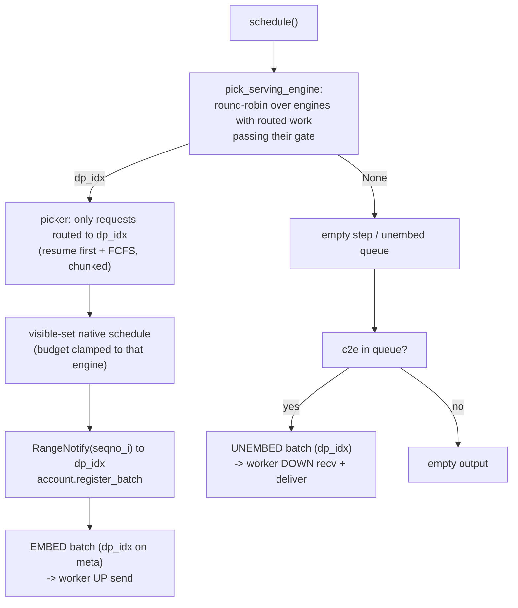

闸门（每个账本，`is_gated` 判定）：

- 在途续传豁免（先把在途 chunk 收完；也避免 `max_num_seqs=1` 的自锁）；
- 引擎槽位满（`load >= max_num_seqs`）或未消费 chunk 到上限
  （`LWD_MAX_PENDING_CHUNKS = 3`）时 HOLD；
- 单个引擎被按住不影响其他引擎：选择器跳过它，服务下一个有活的引擎。

## 云侧步（MoE DP）

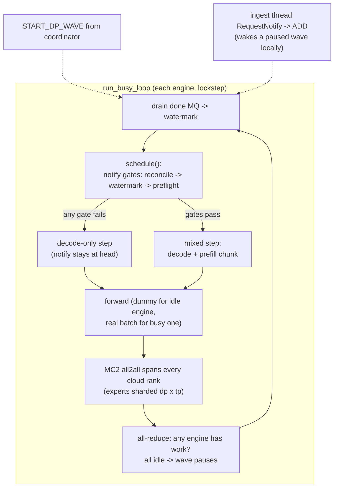

锁步是强制的、不是开销：DP_i 的前向需要全部云 rank 参与 MC2 all2all，空闲引擎
以相同节奏跑 dummy batch——"陪跑"引擎是忙引擎这一步算力的一半。非 MoE 云侧
全部跳过：独立引擎、无 coordinator、无 dummy。

### 步调一致的协商点：每步末尾的两个布尔值

**两条流水线确实独立跑，但每一步的结尾有一个强制的"对表"点——不需要任何下发前的协商。**
这是理解锁步机制的关键：云引擎**不需要提前知道**"这步是陪跑还是真活"，
它是**先跑、后对表、再决定下一步**：

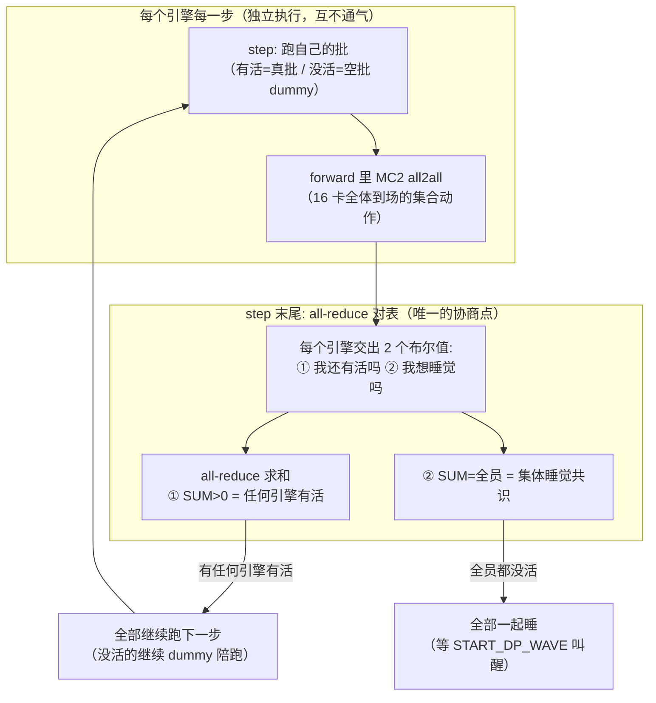

回答"云怎么知道这步是陪跑还是真数据"：**它不知道，也不需要知道。**
每个引擎每一步只做一件事——看看自己队列里有没有可跑的活：有就跑真批，没有就跑一个
空批（dummy，全零输入走一遍前向）。dummy 和真批在前向里是不可区分的集合通信参与方：
MC2 all2all 只认"到场"，不问"你带来的是真 token 还是零"。所以两边步调一致的保证
不是靠下发时声明，而是靠**集合通信本身的阻塞性**——引擎 0 的 all2all 不发完，
引擎 1 的 all2all 就回不来，两边的每一步天然对齐。

对表点（`_has_global_unfinished_reqs`，步末 all-reduce）交换的**只有两个布尔值**：
"我还有没有活"、"我是否申请睡觉"。SUM 出来两个全局结论：只要有任何一个引擎有活，
全体继续跑（没活的继续陪跑）；全员都没活，达成睡觉共识，集体暂停等叫醒。
**没有任何请求身份、数量或内容跨引擎流动。**

边侧同理不需要协商：边每一步只管发自己选中的那个引擎的批；另一条"流水线"
（另一引擎的批）只是暂时轮不到，不是被谁拦住。边的步频和云的步频之间
没有对齐要求——UP/DOWN 通道是异步队列，云侧的 pre-recv 机制让数据
"到了就用、没到先跑别的"，两条流水线靠队列解耦，不靠步频同步。
## Wave 唤醒

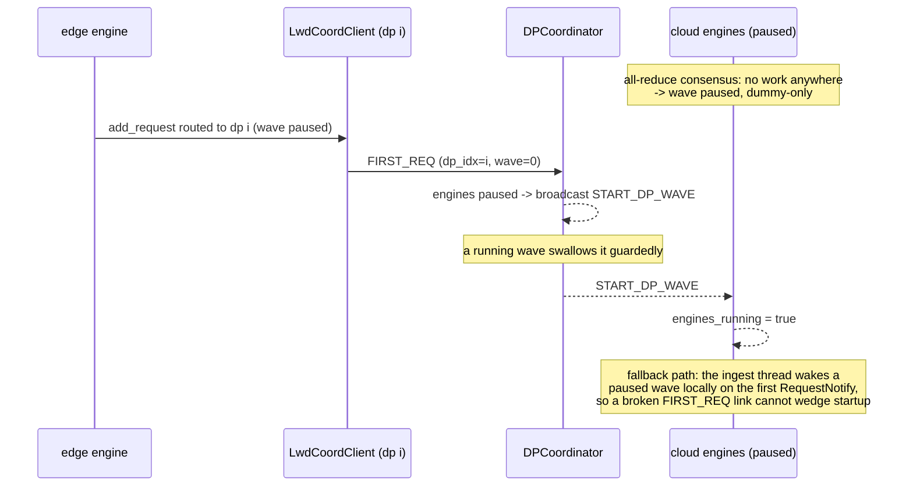

coordinator 的 stats 端点在 LWD 下必须是云拓扑地址上的可路由 TCP 端点
（单机内部 LB 形态默认选 IPC 路径，边侧永远拿不到可路由地址——两个引擎停在
暂停 wave 里，首个请求在 UP 传输完成上报之后挂死，联调踩过）。

## 部署

1 边卡 + 2 个 TP8 云引擎（world = 17）：

```yaml
deployment: {mode: 0, scene: single_instance, hccl_world_size: 17, edges_num: 1, clouds_num: 1}
edges:
  - id: 0
    dp:
      - {dp_idx: 0, addr: <edge-ip>, ranks: [0]}
      - {dp_idx: 1, addr: <edge-ip>, ranks: [0]}   # 共享同一个边进程
clouds:
  - id: 0
    dp:
      - {dp_idx: 0, addr: <cloud-ip>, ranks: [1..8], ctrl_port: 5550}
      - {dp_idx: 1, addr: <cloud-ip>, ranks: [9..16], ctrl_port: 5551}
instance_links: [{edge: 0, cloud: 0}]
```

拉起参数：边侧 `--data-parallel-size 1 --tensor-parallel-size 1`，
`--master-addr <边侧IP> --master-port <端口>`；云侧
`--data-parallel-size 2 --tensor-parallel-size 8`，master addr/port 与边侧相同
（共享 world 汇合点；全局 rank 0 是边，store 宿主必须是边）。云引擎间的
DP gloo store 地址默认 loopback，不回退 master_addr（那是边侧宿主，store
放那边永远连不通）；跨机云引擎需显式 `--data-parallel-address`。
`dp_coordinator_addr` 随 `LwdCloudParamsNotify` 传递，改写为云拓扑地址。

云侧显存：每引擎 KV 预算 = 集中式 TP8 预算 − 更大的 MC2/EP 通信域足迹
（EP=dp×tp 罩两引擎 16 rank，这是共享专家池的代价，参照分支同样存在）。
`--max-model-len` 必须适配该预算：启动期检查会拒绝"单请求 KV 需求 > 可用量"
的配置（67700 长度对 4.4 GiB 可用即拒绝，改小 max_model_len 或提高
gpu_memory_utilization）。

## 范围外

- `edge_share` / `cloud_share` / `lwd_cluster`：实例间共享边 rank、一个云 DP rank
  挂多条连接，仍需多 peer 控制面（见 lwd_control_plane.md 的 Roadmap）。
- 云侧 abort 通告（单 DP 同样缺失）、peer 失联检测、云重启重连。
- 参照分支的模型层多 DP 适配（GLM / DeepSeek-V2 边侧 norm 处理、按角色权重
  加载、检查点切分）另批迁移。

## 验证计划

单测（CPU）：组推导（多 DP 拓扑）、多链路控制面（握手、定向发送、按链路归因、
缺云 fail-fast）、账本与路由闸门（含负负载与完结槽位释放两个回归形态）、
picker 回归。

真机 ST（910B）两个里程碑均必须：M1 非 MoE 端到端；M2 MoE（专家跨引擎分片、
MC2 组罩全云、wave/dummy 锁步、MTP proposer 与 dummy 的交互），另加
持续并发浸泡（≥500 请求）验证账本收支平衡——账本泄漏只在持续并发下暴露。
