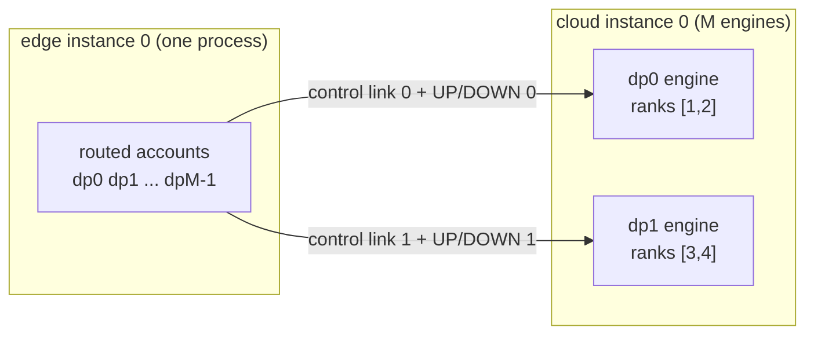
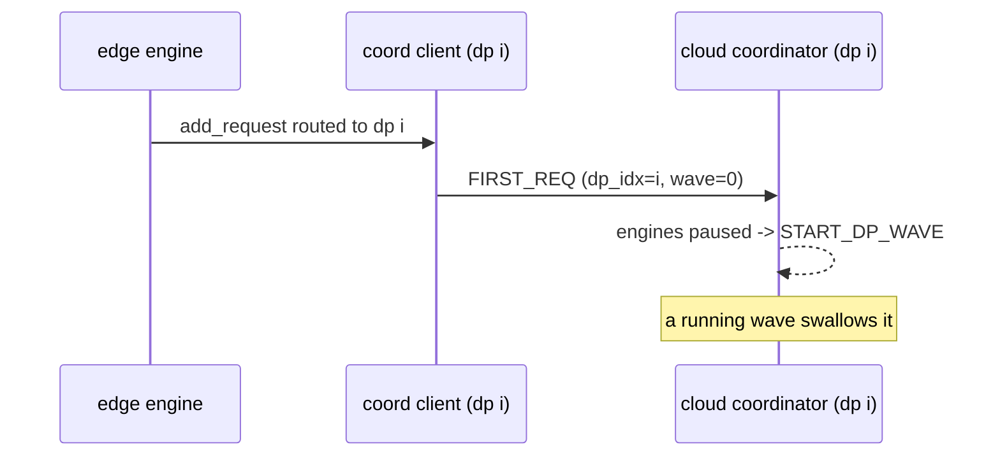

# LWD Multi-DP

A `single_instance` topology may run several cloud DP engines behind one
edge process. This document describes how the edge serves every DP
connection and how the cloud stays a native DP deployment.

## Principle

The cloud behaves exactly like a centralized DP deployment; the LWD delta
is only where its traffic comes from:

- a MoE cloud runs its engines on the native DP engine core
  (`LwdCloudDPEngineCore` = `LwdCloudEngineCoreMixin` + `DPEngineCoreProc`),
  keeping the wave state machine, dummy batches, START_DP_WAVE and the
  dp x tp expert sharding; a non-MoE cloud runs independent engines
  (`LwdCloudEngineCore`).
- the edge is the front-end stand-in: it routes requests with the native
  DP balancer's score weights, and it sends FIRST_REQ to wake a paused
  wave (nothing else would: the cloud has no front-end traffic).

## Topology

- The edge DPs share their ranks (one process serves every connection);
  the spec collapses them into one allocation. Each cloud DP is one
  engine process over its own rank allocation.
- Rank groups (vllm `LwdParallelGroupsSpec`, single source for both
  repositories): TP = one group per edge instance and cloud DP; DP =
  singletons, or the co-located ranks across the cloud DPs for MoE; EP
  and MC2 (MoE) = one group per edge instance and one spanning every
  cloud rank of an instance (dp x tp sharding; engine-per-engine groups
  would let tokens reach only a fraction of the experts); PP, DCP, PCP
  stay singletons.
- Multi-node DP ranks of one instance are rejected: the inner-DP world
  derives its grid from the native uniform layout.

## Edge scheduling

One `LwdCloudDpAccount` per connection holds the seqno stream (the UP
pairing contract is per channel), the pending prefill batches, the
request loads and the gate state. The routing table (request id ->
dp_idx) is pinned at admission and never changes, so a request's chunks,
aborts and results all travel through its engine's account.

Each schedule step serves one engine: engines with routed work that pass
their gate are served round-robin; the picker takes only that engine's
requests, so one range notify, one seqno and one UP channel belong to
exactly one engine. A gated engine (slots full or pending chunks at the
cap) never holds the others; a resume in flight is exempt from its
engine's gate. The routing score weighs prefill 4 and decode 1, the
native DP balancer's weights.

## Control plane

The edge plane holds one DEALER per link (link i connects to cloud DP
rank i and registers as that link's dp_rank). One DEALER per link, not
one DEALER with several connects: a multi-connect DEALER round-robins
sends across the clouds and replies cannot be attributed to a link.
Held outbound payloads are per peer. `wait_until_ready` requires every
cloud handshake and its scheduling limits within one handshake timeout;
a mismatched limit or a missing cloud fails the startup. Each link's
`LwdCloudParamsNotify` carries that DP rank's coordinator stats address.

## Data plane

Channels key by `(dp_idx, channel)`: the edge endpoint rank holds the
channel pair of every connection, each cloud endpoint its own. Transfer
FIFOs key by `(dp_idx, channel, op)`; abort holes and reorder buffers
separate naturally. The edge worker picks the connection from the batch
(`LwdEmbedBatch`/`LwdUnembedBatch` carry `dp_idx`); each cloud worker
resolves its engine's endpoint rank from its own DP allocation and posts
recvs on its connection only. Warmup walks every connection's channels
in a fixed global order (connection order, UP then DOWN).

## FIRST_REQ

The coordinator address comes per link from the cloud's params notify
(rewritten to its topology address); without a coordinator (single DP,
non-MoE) there is no client. Stats coming back are reconciliation logs
only; routing uses the local accounts.

## Out of scope

- `edge_share`, `cloud_share`, `lwd_cluster`: edges sharing ranks across
  instances and several connections onto one cloud DP rank still need
  the multi-peer control plane (see `lwd_control_plane.md` roadmap).
- Cloud abort notify (single-DP gap as well), peer loss detection,
  cloud restart reconnection.
- Model-level multi-DP adaptations from the reference branch (GLM /
  DeepSeek-V2 edge norm handling, per-role weight loading, checkpoint
  splitting) migrate separately.

## Validation plan

Unit (CPU): group derivation (multi-DP topology), multi-link control
plane (handshake, directed sends, per-link attribution, missing cloud),
per-DP accounts and routing/gating, picker regression. Real-machine ST
(910B) remains mandatory for both milestones: M1 non-MoE end-to-end,
M2 MoE (expert sharding across engines, MC2 groups spanning the cloud,
wave/dummy lockstep, MTP proposer under dummy batches).
