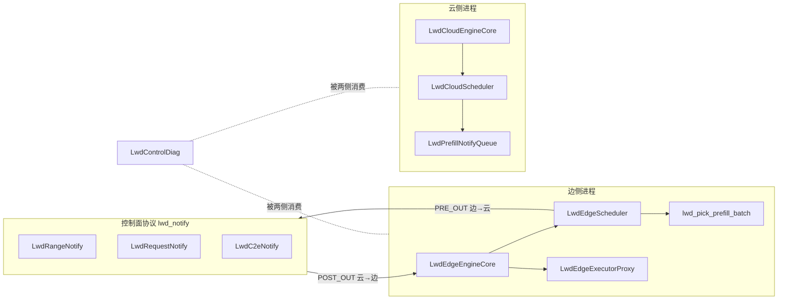
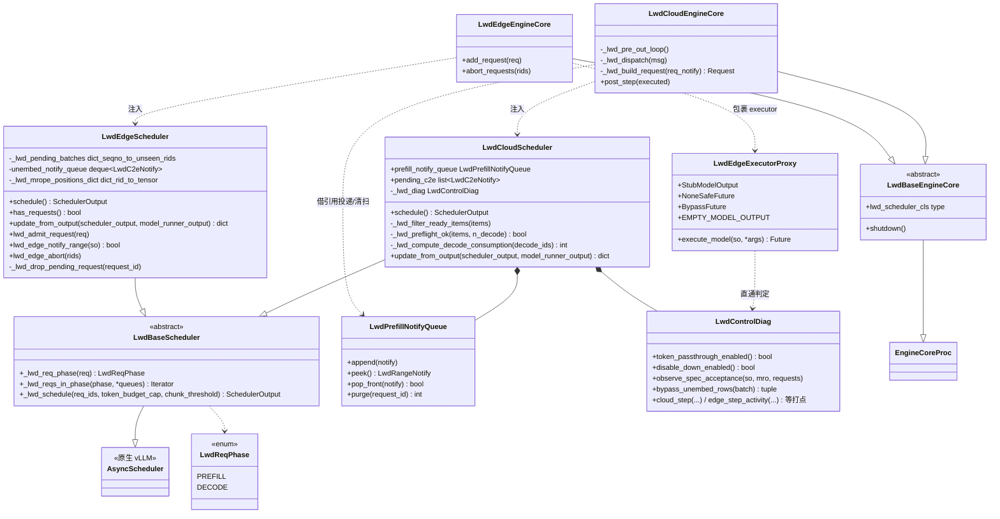
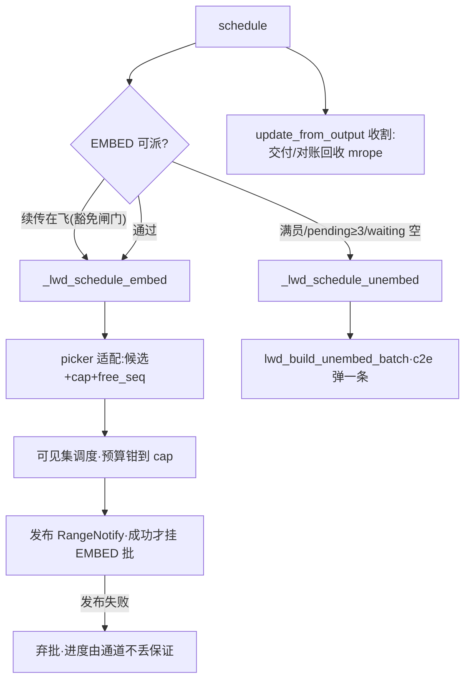
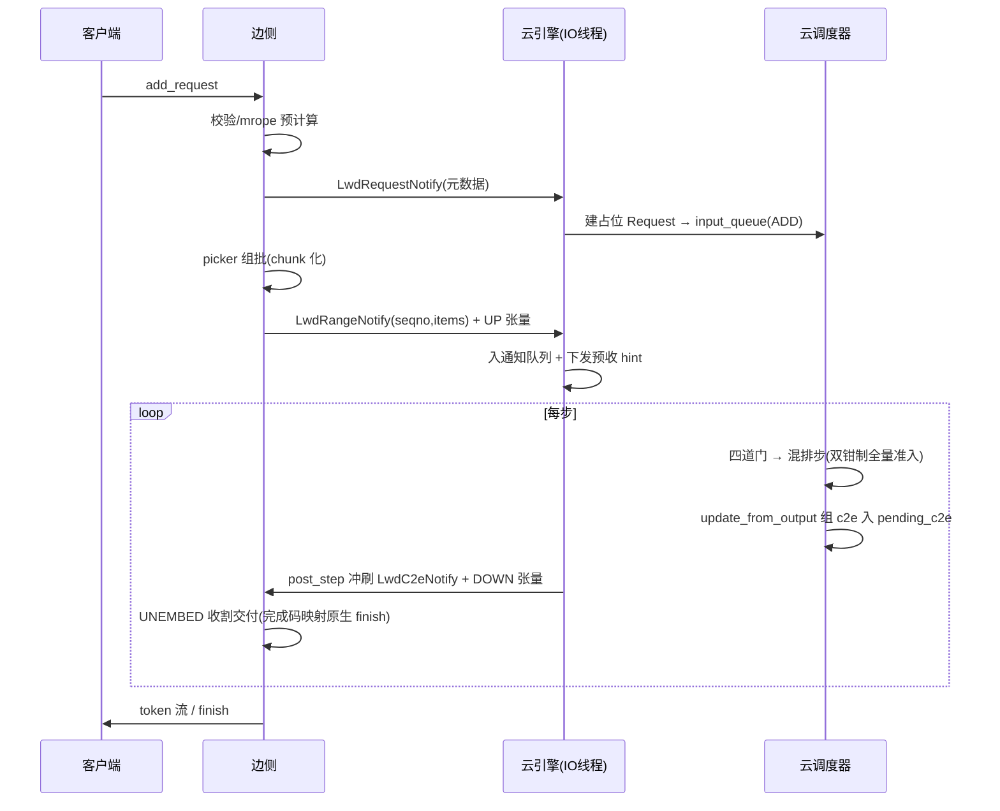
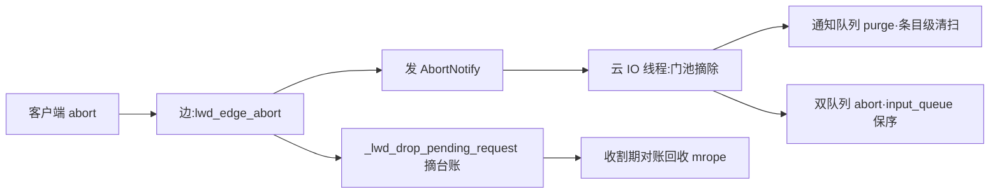
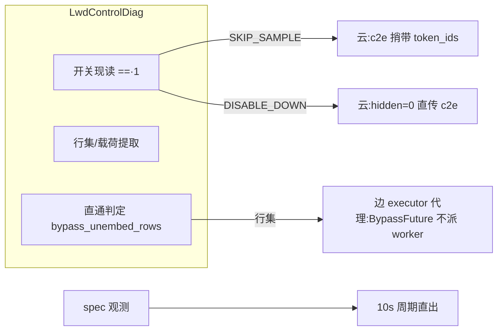

# LWD 边云控制面 · 全量设计文档（v5）

| 项 | 值 |
| --- | --- |
| 基线 | v4（`c00cac309` 原生化，2490 行 / 15 文件） |
| 现状 | `467ad7167`：2678 行 / 18 文件；测试 38 用例（38 过 3 跳，跳过项为轻量环境缺 torch/3.10） |
| v5 增量 | `6122641e7` 摘账修复 → `8626bc826` 结构压缩（借鉴 `prefill_only_refact_scheduler`）→ `c618a8e54` 诊断收口 → `467ad7167` executor 代理统一 |
| 分支 | `prefill_only_ww_1009_refact`（已推 origin） |
| 配套 | 演讲稿 `lwd_control_talk_v5.md` · 台账 `lwd_control_deepening_design.md` · v4 `lwd_control_design_v4.md` |

---

## 1 · 包在边云架构中的位置

LWD prefill_only 把一次推理拆到两个进程：边侧持有真实 prompt 与 tokenizer，只做 embedding；云侧拿占位零值缓冲跑完整 decode。控制面（本包）承载四件事：模式判定与装配、两侧调度语义、通知协议、诊断。数据面张量在 vllm-ascend 仓，经 `SchedulerOutput.lwd_batch` 与 UP/DOWN 通道按 seqno 配对对接。



## 2 · 文件目录

```
vllm/v1/lwd_control/                       2678 行 / 18 文件
├── __init__.py                       7   包说明（诊断收口在 lwd_control_diag）
├── lwd_control_diag/                     诊断层（只出判定与数据）
│   ├── __init__.py                   9   出口：LwdControlDiag
│   └── lwd_control_diag.py         194   开关现读/打点转发/spec 观测/旁路载荷
├── control_communication/               传输层（只认方向不认边云）
│   ├── lwd_notify.py               173   wire 协议：6 结构 + 编解码唯一入口
│   ├── lwd_control_communicator.py  66   ZMQ 收发句柄（单线程亲和）
│   ├── lwd_control_publisher.py    110   OUTBOUND：有界队列 + 自有线程
│   └── lwd_control_subscriber.py    85   INBOUND：阻塞 recv + 坏包丢弃
├── control_scheduler/                   两侧公共基类
│   ├── __init__.py                   8   依赖方向声明
│   ├── lwd_base_scheduler.py       108   LwdReqPhase 三件套 + 可见集原语
│   └── lwd_base_engine.py          40    调度器注入时序 + 收发两面生命周期
├── control_edge_scheduler/              边侧
│   ├── lwd_edge_scheduler.py      686   准入校验/闸门/组批适配/发布/收割
│   ├── lwd_edge_picker.py         161   组批纯函数（表驱动可测）
│   ├── lwd_edge_executor_proxy.py  82   executor 边界代理（内部类封 future 家族）
│   └── lwd_edge_engine.py         183   通信面装配 + HELLO 互校 + 原生步进
└── control_cloud_scheduler/             云侧
    ├── lwd_cloud_scheduler.py     375   notify 门控混排 + preflight + 双钳制
    ├── lwd_prefill_notify_queue.py 67   IO 线程/主线程通知队列（锁纪律唯一住处）
    └── lwd_cloud_engine.py        322   PRE_OUT 循环 + 请求过门 + post_step 冲刷
```

配置不在包内：`vllm/config/lwd.py` 的 `LwdConfig`（181 行，additional_config 段 + env 覆盖）与 `lwd_spec_factor()`（MTP 预算系数公式唯一住处）。引擎类选择内联在 `vllm/v1/engine/core.py`（约 10 行，读 `vllm_config.lwd_config` 分流）。

**依赖方向**（grep 守卫测试锁定）：云侧包禁止 import 边侧包；诊断包零功能依赖；picker 纯 stdlib；传输层不 import 调度/执行类。

## 3 · 类图



模块级函数（非类）：`lwd_pick_prefill_batch(running, waiting, *, cap, free_seq, chunk_unit, single_prefill_min_tokens)` 与候选 `LwdPrefillCandidate`（边侧 picker）；`lwd_build_unembed_batch(notify)`（边侧 UNEMBED 批构造）。

## 4 · 接口清单（对外签名）

### 4.1 基类 `control_scheduler/`

| 接口 | 语义 |
| --- | --- |
| `LwdReqPhase` / `_lwd_req_phase(req)` | 唯一相位判据：`num_computed < num_prompt` → PREFILL，否则 DECODE |
| `_lwd_reqs_in_phase(phase, *queues)` | 按相位扫多队列生成器，跳过已终结请求（消边云五处同构扫描） |
| `_lwd_schedule(req_ids, *, token_budget_cap=None, chunk_threshold=None)` | 隔离调度：只排指定请求（其余隐藏），三队列剔除-调度-拼回；钳制仅收紧不放宽；名额按隐藏驻留数扣减 |
| `LwdBaseEngineCore.lwd_scheduler_cls` | 子类声明调度器类；注入必须先于 super()（scheduler_cls 一次性消费） |

### 4.2 边侧 `control_edge_scheduler/`

| 接口 | 语义 |
| --- | --- |
| `LwdEdgeScheduler.schedule()` | EMBED 优先出批，否则消费 c2e 出 UNEMBED 批 |
| `LwdEdgeScheduler.has_requests()` | 原生步进取活谓词（EMBED 可派 / c2e 待消费） |
| `LwdEdgeScheduler.update_from_output(scheduler_output, model_runner_output)` | LWD 收割：UNEMBED 逐请求交付（完成码映射原生 finish），EMBED 无本地出账；mrope 对账回收 |
| `lwd_admit_request(request) / lwd_edge_notify_range(scheduler_output) / lwd_edge_abort` | 边准入（校验+mrope，本地账）/ 批发布（seqno 与发布成功绑定）/ abort 台账摘除；云预告与入队归引擎 `add_request`（通信在引擎） |
| `_lwd_drop_pending_request(request_id)` | pending 台账消除（首 token/终结/abort 三路共用），批内清空即整条移除 |
| `lwd_pick_prefill_batch(...)` | 组批纯函数：续传优先 + FCFS 前缀 + 末位截断 + 独占规则，不变量 Σexpected ≤ cap |
| `LwdEdgeExecutorProxy.execute_model(so)` | 三项契约：None→空占位、诊断直通（判定来自 diag）、属性透传 |

### 4.3 云侧 `control_cloud_scheduler/`

| 接口 | 语义 |
| --- | --- |
| `LwdCloudScheduler.schedule()` | 四道门决策：就绪过滤（all-or-nothing）→ 提前收水位 → preflight 三检 → 混排 |
| `_lwd_filter_ready_items(items)` | 预告条目对账：ready / stale（幂等剔除）/ unknown（ADD 未落地 → 整批 defer） |
| `_lwd_preflight_ok(items, n_decode)` | token 预算 / 名额（只数新增）/ KV 保守预估 |
| `_lwd_compute_decode_consumption(decode_ids)` | decode 精确消耗推导：逐字复刻原生 num_new（含 max_tokens 守卫与节拍守卫的零消耗分支） |
| `update_from_output(scheduler_output, model_runner_output)` | 原生入账后解 carrier 组 c2e 入 `pending_c2e`（纯记账无 IO），引擎 `post_step` 冲刷 |
| `LwdPrefillNotifyQueue` | `append/peek/pop_front/purge`，一把锁串行，身份弹队防 purge 竞态 |
| `LwdCloudEngineCore._lwd_build_request(req_notify)` | 字段表重建采样参数 + 占位零值 embeds（前缀缓存哈希链未随控制面移植，功能另上） |

### 4.4 诊断 `lwd_control_diag/`

| 接口 | 语义 |
| --- | --- |
| `token_passthrough_enabled / disable_down_enabled` | 开关调用点现读（严格 `=="1"`，进程内改 env 即时生效） |
| `observe_spec_acceptance(scheduler_output, model_runner_output, requests)` | spec 接受率按原生口径累计，10s 周期直出 |
| `bypass_token_payload / disable_down_rows` | SKIP_SAMPLE 载荷 / DISABLE_DOWN 行集（finished 补空行） |
| `bypass_unembed_rows(batch)` | 直通判定与行集；只出数据，future 包装归 executor 代理 |
| `set_debug / edge_step_activity / edge_tokens_delivered / cloud_step / cloud_request_admitted` | lwd_debug 在包内的唯一进口 |

## 5 · 数据结构

### 5.1 wire 协议（`lwd_notify.py`，msgspec，编解码四函数为唯一入口）

| 结构 | 方向 | 字段 | 说明 |
| --- | --- | --- | --- |
| `LwdRangeNotify` | 边→云 | `seqno` + `items: list[LwdRangeItem]` | 一批预告一条：整批原子性、seqno 为 UP 配对键 |
| `LwdRangeItem` | 同上 | `request_id / offset / num_tokens / has_mrope / mrope_positions(bytes)` | 逐 chunk 条目；mrope 原始字节走控制面（wire v2） |
| `LwdRequestNotify` | 边→云 | 请求元数据 + `LWD_SAMPLING_FIELDS` 采样字段表 | 云侧据字段表重建 SamplingParams；eos_token_id 走原生回填 |
| `LwdAbortNotify` | 边→云 | `request_id` | 云侧清扫 + 双队列 abort（abort 链路功能未上，wire 定义保留） |
| `LwdHelloNotify` | 云→边 | `pre_out_host/port` + 调度三元组 | 端点唯一事实源；三元组供边侧互校（cap/preflight 同源输入） |
| `LwdC2eNotify` | 云→边 | `hidden_num_elements / top_id_ths / num_accepted_tokens / req_ids / finish_reasons / down_seqno / token_ids` | 步元数据先于 hidden 张量到达；`token_ids` 仅诊断旁路携带 |
| 常量 | — | `LWD_NOT_FINISHED = -1`、`LWD_SAMPLING_FIELDS/DEFAULTS` | 完成码哨兵；采样字段表（边云同表驱动） |

### 5.2 调度器状态（全部步内单线程，除通知队列）

| 持有者 | 结构 | 语义 |
| --- | --- | --- |
| 边调度器 | `_lwd_pending_batches: dict[seqno, set[rid]]` | 一本账：未到账请求集，pending 水位 = len；批清空即移除 |
| 边调度器 | `unembed_notify_queue: deque[LwdC2eNotify]` | c2e 待消费（接收线程 append / 主步 popleft） |
| 边调度器 | `_lwd_mrope_positions_dict: dict[rid, Tensor]` | 准入期算好的整 prompt positions，收割期对账回收 |
| 边调度器 | `_lwd_seqno` / `_lwd_chunk_unit` / `_lwd_spec_factor` | 发布计数（peek-then-advance）/ chunk 单元 C / MTP 系数 |
| 云调度器 | `prefill_notify_queue: LwdPrefillNotifyQueue` | IO 线程投递、主线程消费（锁纪律唯一住处） |
| 云调度器 | `pending_c2e: list[LwdC2eNotify]` | 步元数据暂存，post_step 统一冲刷 |
| 引擎侧 | `_lwd_gate_pending: dict[rid, wire]`（云） | 元数据查重与落地门 |
| 代理 | `EMPTY_MODEL_OUTPUT`（类级单例） | None 兜底空占位 |

### 5.3 线程模型

| 进程 | 线程 | 职责 | 纪律 |
| --- | --- | --- | --- |
| 边 | 主循环 | schedule / update_from_output / 台账 | 步内单线程 |
| 边 | `lwd-post-in` 接收线程 | HELLO retarget + c2e 入 deque + WAKEUP 敲门 | deque 单操作原子 |
| 边 | `lwd-publisher` | 有界队列编码发送 | 队满 publish 返回 False 背压 |
| 云 | 主循环 | 混排调度 / 入账 / pending_c2e | 步内单线程 |
| 云 | `lwd-pre-out` IO 线程 | 三类分派 + 通知队列投递/清扫 + 预收 hint | 通知队列一把锁 |
| 云 | `lwd-publisher` | 同边 | 同边 |

## 6 · 流程图

### 6.1 边侧一步调度



### 6.2 云侧混排一步（四道门）

```mermaid
flowchart TB
    A[收集 decode 候选·相位生成器] --> B[peek 队首预告]
    B -- 无 --> D[decode-only 可见集]
    B --> C[分类:ready/stale/unknown]
    C -- unknown --> |整批 defer·留队首| D
    C -- 全失效 --> |弹队| D
    C -- ready --> G[提前收闸门:水位 ≥ seqno]
    G -- 未收完 --> D
    G --> P[preflight:token/名额/KV]
    P -- 不过 --> |留队首重试| D
    P --> M[_schedule_mixed]
    M --> M1[decode 消耗推导·逐字复刻原生]
    M --> M2[隔离调度·双钳制:预算=decode消耗+Σchunk,阈值=max]
    M2 --> M3[挂 EMBED 批·seqno 同源·弹队]
```

### 6.3 请求全生命周期



### 6.4 abort 双侧



### 6.5 诊断旁路



## 7 · 正确性支柱（v4 两条硬约束的现行实现）

1. **张量在预告后面飞**：云侧排程量必须逐请求等于预告量。实现 = 可见集（必然被访问）× 五出口封死（逐字复刻 decode 消耗推导 / 恰好预算 / 阈值上界 / 名额扣减 / KV 上界预估）。算术保证，无步后断言——`_lwd_verify_full_admission` 随 v4 移除，是否恢复轻量核验为待拍板项。
2. **一步只产一个 SchedulerOutput**：decode 消耗预先推导（`_lwd_compute_decode_consumption`），预告当预算用（token_budget_cap），c2e 记账与发布分离（pending_c2e + post_step）。

## 8 · 测试面（38 用例）

| 文件 | 覆盖 |
| --- | --- |
| `test_lwd_edge_picker.py` | 组批算术 18 例表驱动（截断/名额/独占/次序） |
| `test_lwd_prefill_notify_queue.py` | FIFO/身份弹队/条目级 purge/双线程烟雾 |
| `test_lwd_control_diag.py` | 开关严格性与现读/载荷对齐/spec 口径/直通门控 |
| `test_lwd_edge_executor_proxy.py` | None 适配/透传/直通短路底层/内部类不外泄 |
| `test_lwd_config.py` | LwdConfig 解析与 env 覆盖（真实环境跑） |
| `test_lwd_public_surface.py` | 三张守卫网：外部 import 面/依赖方向/诊断纯度 |

## 9 · 待拍板与后续

- 混排步后是否恢复逐请求排程量核验（十行以内，算术保证的断言化兜底）
- 真机冒烟：日志序列与基线比对（重点：终结摘批、mrope 对账回收两处行为修正）
- 参考分支 `prefill_only_refact_scheduler` 的 wire 演进（`eos_discard`/`token_offsets`/mrope 行序）是否纳入，属协议变更需两侧同步立项
