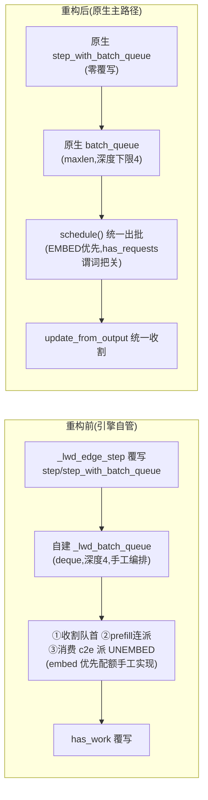

# lwd_control 重构前后流程差异对照

> 基线：`86d12a0c5`（2026-09-29，3497 行 / 12 文件）
> 现状：工作树（2026-10-08，2551 行 / 15 文件，净减 946 行 / −27%）
> 供检视用；逐项变更记录见 `lwd_control_deepening_design.md` v3 变更 A–J 条。

## 0 · 一句话总结

重构没有改调度语义（chunk 划分、四道门、双钳制、picker 算术、wire 协议全部不变），改的是**三件事**：边云两侧的批产出与收割统一收口到原生 `step_with_batch_queue` / `update_from_output` 主路径；请求生命周期回到原生调度器（单一事实源）；防御性编程与调试残留清除。PD 分离相位机按拍板整链删除。

## 1 · 总量对照

| 维度 | 重构前（86d12a0c5） | 重构后 |
| --- | --- | --- |
| 包内行数 / 文件 | 3497 / 12 | 2551 / 15 |
| 边引擎 | 545 行，step/add/abort/has_work 全覆写，自建批队列编排 | 265 行，**步进零覆写**，通信面装配 + 三项构造期适配 |
| 边调度器 | 867 行（picker 内联 + awaiting 三本 dict 摊在五个方法） | 693 行（picker 外联，统一出批 + 统一收割） |
| 云引擎 | 614 行（c2e 钩子链 + 门池 + purge + env 散读） | 306 行（部署校验 + IO 线程 + post_step 冲刷） |
| 云调度器 | mixed 495 + phase 235（两套） | 443（唯一形态，PD_mix） |
| 配置 | lwd_edge_assemble.py 157 行，判型四处拼写 | vllm/config/lwd.py 扩展（配置上提）；包 __init__ 27 行只剩诊断 helper |
| core.py 的 LWD 残留 | 引擎选择 + 模型输出钩子链 + 每步 trace 日志 | 仅引擎选择 10 行 |
| 测试 | 0 | 5 文件 30 用例（picker 表驱动 / 通知队列 / 公共面 / 配置） |

## 2 · 边侧流程差异（重点）

### 2.1 步进：自建编排 → 原生批队列



| 环节 | 重构前 | 重构后 |
| --- | --- | --- |
| 谁驱动步进 | 引擎覆写 `step`/`step_with_batch_queue`/`has_work` 三件 | 全部删除，直用父类；`has_work` 由原生三判据 + 谓词覆写天然覆盖 |
| 批队列 | 自建 deque，元组 `(kind,payload,t_dispatch,future)`，收割次序手工保证 | 原生 batch_queue，构造期把深度下限设 4（size 与 maxlen 同步重建，防 appendleft 静默挤掉在飞批） |
| UNEMBED 批产出 | 引擎从 c2e 队列消费，`lwd_build_unembed_batch` 组批后**直投 executor** | c2e 进调度器 `unembed_notify_queue`，`schedule()` 统一产出，与 EMBED 走同一条原生队列 |
| embed 优先 | 引擎编排里显式实现（先占配额防 EMBED 被 decode 回程挤出） | `schedule()` 内 EMBED 优先出批 + 原生"填队列优先于收割"天然配合，语义等价 |
| 空批 | 闸门 HOLD 时 `schedule()` 返回 make_empty（自管队列下无害） | **不可能产生**：`has_requests()` 覆写为"有可派发批"谓词，闸门 HOLD 且无在飞时引擎直接睡眠 |
| 底层 None 结果 | 自建步不判定（无此路径） | 原生把 None 判执行失败 → **executor 代理**把"正常完成返回 None"适配为空占位（异常原样穿透） |
| 原生 sample_tokens | 不经过（自建步绕开） | `is_pooling_model=True` 构造期覆写禁用（边侧采样在 execute 内完成）；该属性全仓仅一个消费点 |

### 2.2 请求生命周期：finish 出调度器 + 台账 → 留原生 running

| 阶段 | 重构前 | 重构后 |
| --- | --- | --- |
| 嵌入完结 | `finish_requests(FINISHED_STOPPED)` 清出调度器，登记 awaiting 台账（独立 dict/set 三本账） | **不 finish**，请求留 running 转 decode 相位（`num_computed == num_prompt`，与云侧收集谓词同款） |
| 在途水位 | `len(running) + len(awaiting)` 两套账对账 | `len(running)` 一处读数（decode 相位请求天然计入） |
| 迟到结果判定 | awaiting 台账成员检查 | 原生 `self.requests` 成员检查（单一事实源） |
| 终结 | 台账摘除 + 手工 finished 集交付 | 云端完成码经 `_LWD_FINISH_STATUS` 映射走原生 `finish_requests`（KV/缓存释放与 finished_req_ids 交接白拿） |
| abort | 台账三账齐摘 + AbortNotify | 闸门两本账摘除 + AbortNotify（请求本体走原生 abort） |
| pending 闸门水位 | awaiting 三本账支撑 | **不变**：`_lwd_first_token_seen` + `_lwd_batch_requests` 两本保留（要去除需协议携带云侧消费 seqno，未做） |

### 2.3 收割与交付

| 环节 | 重构前 | 重构后 |
| --- | --- | --- |
| EMBED 收割 | 引擎循环里调 `lwd_edge_update_progress` | 调度器 `update_from_output` EMBED 分支（完结者留 running 转 decode 相位） |
| UNEMBED 交付 | 引擎 `_lwd_deliver_unembed` 手工组 EngineCoreOutputs | 调度器 `update_from_output` UNEMBED 分支（`_lwd_deliver_unembed`），返回值即步输出，原生投 output_queue |
| DISABLE_DOWN 直通 | `future=None` 直通 + `_lwd_direct_pending` 直通积压待冲刷 | **executor 代理拦截**：返回携带旁路 token 的已完成 future，走与正常批完全一致的原生收割/交付路径；调度器对诊断零感知 |

## 3 · 云侧流程差异

| 环节 | 重构前 | 重构后 |
| --- | --- | --- |
| c2e 发布 | core.py 钩子链 `lwd_process_model_output → lwd_handle_model_output`（引擎覆写），每步伴随 trace 日志 | 调度器 `update_from_output` 解 carrier 组 c2e 入 `pending_c2e`（纯记账）；引擎 `post_step` 原生钩子统一冲刷。core.py 钩子链与调试日志全删 |
| 模式判定/引擎选择 | `lwd_serve_guard`（serve 入口）+ `lwd_resolve_engine_cls`（包入口）+ 判型四处拼写 | serve 守卫删除（部署校验内联 `_lwd_setup_zmq` 头部）；core.py 内联 10 行选择块 |
| 配置解析 | `lwd_edge_assemble.py` 自带段解析 + env 覆盖 | 传输字段并入 `vllm/config/lwd.py` 的 LwdConfig（搭 additional_config 解析 + legacy 段回退 + env 覆盖坏值告警）；`lwd_spec_factor` 公式同居 |
| PRE_OUT 线程 | `process_input_sockets` 覆写起线程 | 构造期直接起（socket 仍在 IO 线程内建，zmq 亲和不变） |
| 请求落地 | 门池 gate_pending + `_lwd_promote` 两跳 | 消息直投 input_queue（重复元数据守卫随防御清除删除） |
| 通知队列 | 裸 deque + 引擎 purge 整体替换 + 调度器按对象身份防御弹队 ×2 | `LwdPrefillNotifyQueue`（一把锁，append/peek/pop_front/purge），线程纪律唯一住处 |
| 调度内核 | 可见集 + 手搓 save/restore 钳制 | **语义不变**：预算/阈值钳制与隐藏期名额扣减折进基类 `_lwd_schedule_for_visible_reqs`（仅收紧不放宽） |
| 采样参数重建 | 边组包/云建请求各抄 20 行字段 | `LWD_SAMPLING_FIELDS` 一张表两侧共用 |
| spec 系数公式 | 三处复写 | `lwd_spec_factor` 单点 |

## 4 · 完全不变的部分（检视时不必重看）

- **wire 协议零字节变化**：lwd_notify 的结构、字段、seqno 语义、wire_version=2 全部未动
- chunk 组批算术（picker 语义与表驱动测试锁定的边界）
- 云侧四道门（分类 / ADD 落地 defer / 提前收水位 / preflight 三检）
- offset 语义（云侧仍按预告 offset 对齐注入窗口——但**运行时核验已删**，见 §5）
- HELLO 三元组互裁、spec 系数采纳、部署校验（master_addr / pre_out_host / 死锁配置）
- mrope 全链路、encoder 门控绕过、abort 清扫、提前收 hint 机制
- WAKEUP 语义、发布通道不丢消息前提、重试语义

## 5 · 行为差异与风险清单（真机冒烟重点）

1. **防御核验已删（最大行为差异）**：边侧 chunk 步后核验、云侧准入核验与 offset/mrope 对账循环、wire_version 互校、legacy 回退全部移除。上游原生调度若演进导致边云划分漂移，表现从**当场报错**变为**静默错算**。回归防线后移到 CI/联调。冒烟建议：65536 长序列 + 多模态混发各一轮，抽日志比对逐请求排程量与预告量一致。
2. **长驻 decode 相位请求**：边侧请求现终身留在原生 running。AsyncScheduler 旁路（preemption 统计、`is_prefill_chunk` 记账）对它们的行为需真机确认；参考分支同形态已验证可行。
3. **finished_req_ids 交接时序**：终结改在收割时走原生 finish，随下一个 EMBED 批 SO 交接到 worker——纯睡眠期滞后与重构前一致，但路径变了，冒烟看 worker 缓存释放日志。
4. **批队列深度恒 2 硬编码**：`LWD_EDGE_BATCH_QUEUE_DEPTH = 2`（评审定值，原参照仓保守值 4），不受 `max_concurrent_batches` 配置影响；性能验证在真机环境补测。
5. **日志大幅减少**：每步/每批/每请求 INFO 与 perf 探针删除 27 处；保留 fail-fast、闸门 HOLD/OPEN、defer 原因、一次性装配日志。排查手段相应减少，[Lwd][sched]/[Lwd][perf] 系列锚点不复存在。
6. **LwdDebug 默认关**：`ENABLED=False`，热路径先判开关再做 tokenizer 解码；排查期手动置 True。

## 6 · 现状文件清单

```
lwd_control/                        2551 行
├── __init__.py            27   诊断 helper(SKIP_SAMPLE/DISABLE_DOWN 现读)
├── control_scheduler/
│   ├── lwd_base_scheduler 77   可见集原语(预算/阈值/名额参数化收紧)
│   └── lwd_base_engine    40   引擎基类(注入时序/两面生命周期/chunked 恢复)
├── control_communication/        未动(publisher 增 retarget 队列命令已有)
│   ├── lwd_notify         194   +采样字段表
│   └── subscriber         82    +start(handler) 接收线程
├── control_edge_scheduler/
│   ├── lwd_edge_scheduler 693   统一出批+统一收割+生命周期留原生
│   ├── lwd_edge_engine    265   通信面装配+原生步进三适配+executor 代理
│   └── lwd_edge_picker    161   组批纯函数(表驱动测试锁定)
└── control_cloud_scheduler/
    ├── lwd_cloud_scheduler 443  唯一形态(PD_mix);c2e 记账入 update_from_output
    ├── lwd_cloud_engine    306   部署校验+IO线程+post_step 冲刷
    └── lwd_prefill_notify_queue 72  锁化通知队列
```

测试：`tests/v1/lwd_control/` 5 文件 30 用例 + 1 跳过（config 用例需 Python≥3.10 真实环境）。本机跑法：`python3 -m pytest tests/v1/lwd_control/ --confcutdir=tests/v1/lwd_control`。

## 7 · 未做与后续候选

- **pending 闸门两本账去除**：c2e 携带云侧已消费 seqno（协议 +1 int），边侧 pending = 已发布 − 已消费，`_lwd_first_token_seen`/`_lwd_batch_requests` 全删。独立小改。
- **c2e 步内收编的云侧推文时点**：现 post_step 冲刷（步尾），与步内发布微秒级差异，已验证可接受。
- **日志中台**：团队规范 7.12 要求自有日志模块与级别，现状是原生 logger + 前缀约定。
